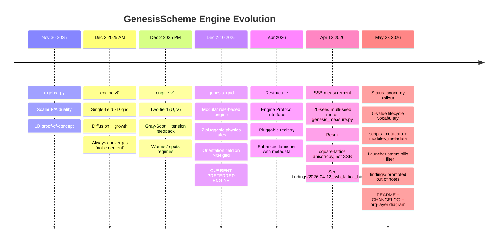
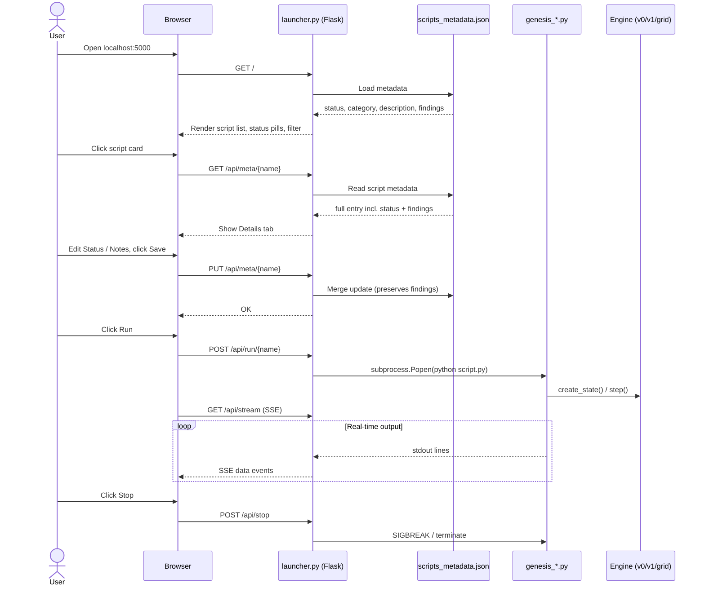

# GenesisScheme Architecture

The diagram below is a single-view mental model of the repo. It uses
the project's standard zone palette: green for entry points, purple
for the metadata layer, teal for the current engine, blue for the
protocol, amber for the legacy engines, grey for scripts and outputs.
Status accents (dashed grey for superseded, red for broken) call out
exceptions. See `docs/status_taxonomy.md` for the status taxonomy and
`diagrams/timeline.mmd` for engine lineage.

```mermaid
graph TB
    %% =========================================================================
    %%  GenesisScheme Architecture — mental-model view
    %%
    %%  Three zones, top to bottom:
    %%    1. User Interfaces — how you start something
    %%    2. Engine + Data + Outputs — what runs and what it produces
    %%    3. Top-level scripts — grouped by lifecycle status
    %%
    %%  Palette matches the project's other diagrams (zone-semantic):
    %%    green=entry           purple=data layer
    %%    teal=current engine   blue=protocol / reference
    %%    amber=legacy engine   yellow=rules / exploratory
    %%    grey=scripts/outputs
    %%  Plus status accents: dashed grey=superseded, red=broken
    %% =========================================================================

    %% ===== ZONE 1: USER INTERFACES =====
    subgraph UI_ZONE["User Interfaces"]
        LAUNCHER["launcher.py<br/>Flask app on localhost:5000<br/><i>script discovery, status pills,<br/>filter, live console, metadata editor</i>"]
        MEASURE["genesis_measure.py<br/>headless measurement harness<br/><i>Tk UI or CLI<br/>single / multi-seed / sweep / compare</i>"]
    end

    %% ===== ZONE 2A: DATA LAYER =====
    subgraph DATA["Data layer"]
        SM["scripts_metadata.json<br/>27 entries<br/><i>fields: status, category, description,<br/>quality, notes, findings, last_modified</i>"]
        MM["modules_metadata.json<br/>27 entries · covers src/"]
        TAX["docs/status_taxonomy.md<br/>5 status definitions"]
        TL["diagrams/timeline.mmd<br/>engine generations"]
    end

    %% ===== ZONE 2B: CURRENT ENGINE =====
    subgraph CURRENT["Current engine — src/genesis_grid/"]
        BACKEND["backend.py<br/>numpy or cupy switch<br/><i>cross-cutting</i>"]
        STATE["core.GenesisState<br/>theta (orientation),<br/>tau, ux, uy, C, X, Y"]
        STEP["core.step(state, params, rules, post)<br/><i>sums rule torques,<br/>applies post hook,<br/>updates theta mod 2 pi</i>"]
        PARAMS["core.GenesisParams<br/><i>flat bag of 18 knobs</i>"]
        RULES["Rules: alignment, compression, curvature,<br/>locking, phase, dipoles, triads, relax<br/><i>pluggable, order-sensitive</i>"]
        RULES_AB["rules_triads_relative<br/><i>exploratory A/B variant</i>"]
        DIAG["diagnostics.py<br/><i>vortex detection, unity<br/>read-only, not in pipeline</i>"]
        ADAPT["adapter.GenesisGridEngine<br/><i>conforms to GenesisEngine protocol</i>"]
        UI_VAR["ui_matplotlib 1/2/3<br/>ui_vispy 1/2/3<br/><i>exploratory variants</i>"]
    end

    %% ===== ZONE 2C: PROTOCOL LAYER =====
    subgraph PROTOCOL["Plug-in protocol — src/genesis_scheme/ (Apr 2026)"]
        PROTO["engine_interface.py<br/>GenesisEngine Protocol"]
        REG["engine_registry.py<br/>register / get / list_engines"]
    end

    %% ===== ZONE 2D: LEGACY ENGINES =====
    subgraph LEGACY["Legacy engines — src/genesis_scheme/"]
        BROKEN_INIT["__init__.py<br/><b>BROKEN</b><br/><i>eager-imports missing<br/>engine/ and engine_v1/</i>"]
        ALG["algebra.py<br/><i>Nov 30 2025 · scalar F/A</i>"]
        ALG2["algebra_2d.py<br/><i>Dec 2025 · 2D rotation</i>"]
        FU["field_unity.py<br/><i>engine v0</i>"]
        GS["gray_scott.py<br/><i>engine v1</i>"]
    end

    %% ===== ZONE 2E: OUTPUTS =====
    subgraph OUT["Outputs"]
        RES["results/<br/><i>per-run JSON,<br/>summary CSV</i>"]
        FIND["findings/<br/><i>dated markdown writeups<br/>YYYY-MM-DD slug md</i>"]
    end

    %% ===== ZONE 3: TOP-LEVEL SCRIPTS by status =====
    subgraph SCRIPTS["Top-level scripts in root (by status)"]
        S_REF["REFERENCE (3)<br/>genesis_grid_emergence<br/>cupy-test<br/>vispy_heatmap_example"]
        S_EXP["EXPLORATORY (19)<br/>genesis_grid_* (7 studies)<br/>genesis_quiver_* (7)<br/>genesis_fields_pretty (3)<br/>coupling_quiver_grid<br/>genesis_arrow_field_large"]
        S_SUP["SUPERSEDED (4)<br/>animate_2d / animate_field<br/>animate_gray_scott<br/>main_scalar_demo"]
    end

    %% ===== RELATIONSHIPS =====
    LAUNCHER -->|reads and writes| SM
    LAUNCHER -.->|reads| MM
    LAUNCHER -->|subprocess Popen| S_REF
    LAUNCHER -->|subprocess Popen| S_EXP
    LAUNCHER -->|subprocess Popen| S_SUP
    LAUNCHER -->|subprocess Popen| MEASURE

    TAX -.->|defines vocab| SM
    TAX -.->|defines vocab| MM
    TL -.->|classifies lineage| MM

    MEASURE -->|imports| STATE
    MEASURE -->|imports| RULES
    MEASURE -->|writes| RES
    MEASURE -.->|results graduate to| FIND
    SM -.->|findings array links to| FIND

    BACKEND --> STATE
    BACKEND -.-> RULES
    STATE --> STEP
    PARAMS --> STEP
    RULES --> STEP
    STEP --> ADAPT

    ADAPT -->|registers| REG
    ADAPT -.->|conforms to| PROTO

    S_REF -.->|imports| STATE
    S_EXP -.->|imports| STATE
    S_SUP -.->|imports| ALG2

    %% ===== STYLING (matches project palette in other diagrams) =====
    classDef launcher   fill:#f0fdf4,stroke:#16a34a,stroke-width:2px,color:#14532d
    classDef iface      fill:#eff6ff,stroke:#2563eb,stroke-width:2px,color:#1e3a5f
    classDef algebra    fill:#faf5ff,stroke:#7c3aed,stroke-width:2px,color:#3b0764
    classDef engine     fill:#fffbeb,stroke:#d97706,stroke-width:2px,color:#78350f
    classDef grid       fill:#f0fdfa,stroke:#0d9488,stroke-width:2px,color:#134e4a
    classDef rules      fill:#fef3c7,stroke:#ca8a04,stroke-width:2px,color:#713f12
    classDef scripts    fill:#f8fafc,stroke:#94a3b8,stroke-width:1px,color:#475569
    classDef superseded fill:#f8fafc,stroke:#94a3b8,stroke-width:1px,stroke-dasharray:4 2,color:#475569
    classDef broken     fill:#fef2f2,stroke:#dc2626,stroke-width:2px,color:#7f1d1d

    class UI_ZONE,LAUNCHER,MEASURE launcher
    class DATA,SM,MM,TAX,TL algebra
    class CURRENT,BACKEND,STATE,STEP,PARAMS,RULES,DIAG,ADAPT grid
    class RULES_AB,UI_VAR,S_EXP rules
    class PROTOCOL,PROTO,REG,S_REF iface
    class LEGACY,ALG,ALG2,FU,GS engine
    class OUT,RES,FIND scripts
    class S_SUP superseded
    class BROKEN_INIT broken
```

### How to read this diagram

- **Start at the top.** Two user interfaces (`launcher.py`, `genesis_measure.py`) are the only things you actually run from a fresh checkout.
- **Middle band, left to right.** The data layer (metadata + taxonomy + timeline) is the source of truth for what's current; the current engine (`src/genesis_grid/`) is where physics happens; the protocol layer is the contract that lets engines plug in; the legacy engines are kept around but no new work goes there; outputs split into machine-generated (`results/`) and human-written (`findings/`).
- **Bottom band.** The 26 other top-level scripts are grouped by status, not by category, because category is what the launcher uses for *layout* but status is what you need to make a *decision* about a file.
- **Color tells you the zone.** Green = entry points, purple = metadata, teal = current engine, blue = protocol / reference, amber = legacy engines, grey = scripts and outputs. Dashed grey marks superseded items inside the scripts catalog; one red node calls out the broken `__init__.py`.

## Engine Evolution Timeline

## Data Flow: Running a Script

## Organization & Lifecycle Layer

The architecture diagram above shows *what* the system is. This second
view shows *how it knows what's current* — the metadata layer that
makes the status labels meaningful.

### Sources of truth

- `scripts_metadata.json` — status for every runnable `.py` in the
  repo root (currently 27 entries).
- `modules_metadata.j