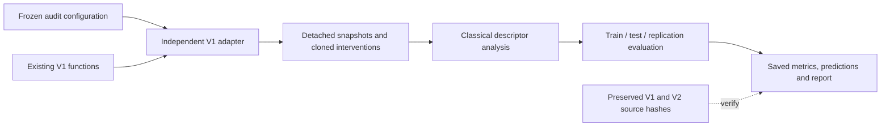

# Genesis Multiscale Organization Audit

## Preservation contract

The user explicitly requires preserving Genesis V1 and V2. This audit is an opt-in analysis package, not a new engine or a rewrite. Neither V1 nor V2 imports it. Its only simulation adapter calls existing V1 functions; V2 implementations remain available and unchanged. Future audit extensions should add adapters or analysis components rather than modify either preserved engine to fit a proposed geometry.

At run start, all Python sources under `src/genesis_grid/` and every `src/genesis_v2*` package are SHA-256 hashed. The same hashes must match at completion. The original V2 regression tests and an exact V1 preset parity test are run separately. Source hashes protect code bytes; they do not establish every possible runtime behavior.

## Components

| File | Responsibility |
| --- | --- |
| [Runner](../../../genesis_multiscale_audit.py) | Validated immutable configuration, protocol written before collection, artifacts, cohort evaluation, source integrity |
| [V1 adapter](../../../src/genesis_audit/v1_adapter.py) | Frozen structural preset, cloned branches, detached snapshots, explicitly named comparison pipelines |
| [Analysis](../../../src/genesis_audit/analysis.py) | Circular descriptors, winding, matched masks, observational controls, ridge evaluation and seed bootstrap |
| [Report renderer](../../../src/genesis_audit/report.py) | Markdown and PNG from saved results; no training or simulation |
| [Audit tests](../../../tests/test_multiscale_audit.py) | Preservation, periodic topology, circular responses, cohort isolation and end-to-end output |



## Default protocol

- Grids: 32×32 and 64×64, periodic.
- Pipelines: V1 structural preset, alignment only, and geometry ablation.
- Training seeds: 1–6. Unseen test seeds: 101–106. Unseen replication seeds: 201–206.
- Sample frames: 300, 450, 600. Four distinct centers per snapshot.
- Perturbation: add a smooth angular Gaussian with amplitude 0.30 radians and width 1.5 sites, to a cloned state. Compare against an untouched clone after 80 updates. The background trajectory never receives the perturbation.
- Targets: RMS phasor differences in radial rings [0,2), [2,4), [4,8) sites. Rings describe response to a globally supported Gaussian; they do not establish a causal cone.
- Context block widths: 2, 4, 8, 16 sites.
- Fixed ridge penalty: 10, with training-only feature standardization and an unpenalized intercept. Target losses are normalized by training-set standard deviations, floored at 1e-6.

The V1 parameters reproduce `genesis_v1_compression_ablation.make_params(0.1)` and its three-rule pipeline. Alignment-only enables just alignment with locking disabled. Geometry ablation disables **both** kappa-driven displacement and shell displacement (`shell_geom_gain`), while retaining the tension and orientation rules. This differs from changing kappa alone, which can leave a displacement path active.

Initial θ uses a local NumPy generator, identically seeded across pipelines. It is not the same random-number stream as older experiments that use the global RNG. The adapter preserves the caller's global RNG state. CPU NumPy is required for this audit's reproducibility contract.

## Fair representation comparison

At each center, both principal models receive the same local-site summary and the same outer square input footprint. One representation summarizes nested blocks; the other summarizes disjoint square shells. The number of features and ridge penalty are identical. Winding descriptors can use a one-site plaquette halo, identically for both representations.

Two input tracks are kept distinct:

- θ-only: mean cosine, mean sine, coherence, signed winding density and absolute winding density.
- Full-state summaries: those five plus tension mean/spread, compression mean/spread, mean x/y displacement, and displacement RMS.

The full-state summary track is the primary one. It is a summary of the enabled V1 state, not a lossless state representation. The θ-only track is secondary. Neither gets future values, event frame, or extra history. Additional references are a smaller local-only predictor, a training-mean predictor, and a zero-response predictor.

Context shuffling preserves the local input and permutes the multiscale context within each seed across sampled times and centers. It is performed separately inside the training and held-out splits, so values never cross cohort boundaries. This is a negative control for event/context association, not a physical trajectory.

## Snapshot controls and limits

Snapshot organization is also measured after joint spatial permutation, independent resampling of angles from the snapshot's empirical marginal, and Fourier phase scrambling. Coherence and winding are descriptive, not entropy estimates. No mutual-information estimator is used in this first implementation.

The Fourier control preserves complex phasor spectral magnitudes before projecting the result back onto unit angles. That projection changes the spectrum. Its post-projection mismatch is recorded; it is explicitly **not** an exact pair-correlation-preserving surrogate. A stronger pair-matched control remains future work if a later positive claim needs it.

## Gate fixed before collection

In both unseen cohorts, the primary multiscale model must beat **each** of the planar-shell, shuffled-context, and training-mean references by:

1. At least 5% relative loss reduction.
2. A strictly positive lower bound of the paired-seed 95% bootstrap interval (2,000 resamples).
3. Wins in at least ceil(0.70 × cohort size) independent seeds: 5 of 6 in the default run.

Both V1 grid sizes must pass. Comparisons for other pipelines and θ-only inputs are secondary. These are conservative exploratory decision gates, not a comprehensive statistical proof. Six seeds per cohort give limited uncertainty estimates. Performance differences between feature representations can reflect ridge regularization or nonlinear summaries; even a pass would not establish a spatial dimension.

Loss normalization is fitted separately within each pipeline/grid dataset. Compare models within a dataset; do not interpret differences in normalized losses across pipelines as direct physical differences.

## Running and inspecting

From the repository root in PowerShell:

```powershell
$env:GENESIS_USE_CUPY = 'False'
$env:OPENBLAS_NUM_THREADS = '1'
& .\.venv\Scripts\python.exe -B -m unittest discover -s tests -v
& .\.venv\Scripts\python.exe -B genesis_multiscale_audit.py --output results/multiscale_audit_new_run
$env:MPLCONFIGDIR = Join-Path (Get-Location) 'work/matplotlib'
& .\.venv\Scripts\python.exe -B -m src.genesis_audit.report results/multiscale_audit_new_run
```

The runner refuses an existing output directory. Give each new run a new directory; an interruption leaves completed raw artifacts and a failure status rather than silently overwriting them.

`protocol.json` freezes settings, feature names, source hashes, environment, and limits before collection. Each seed archive contains detached input snapshots, features, centers, frames, seed IDs, and response targets. `forecasts.npz` retains exact held-out predictions. Organization records, per-dataset summaries, `report.json`, `status.json`, rendered Markdown and PNG preserve the result trail.

The first recorded run is [results/multiscale_audit_2026-10-31](../../../results/multiscale_audit_2026-10-31/summary.md). Its gate was not passed; see [[Genesis Multiscale Organization Audit Results]]. No bulk reconstruction was attempted.
