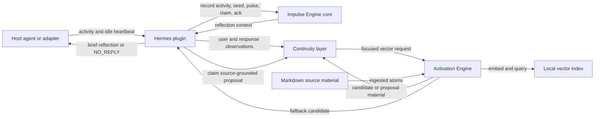
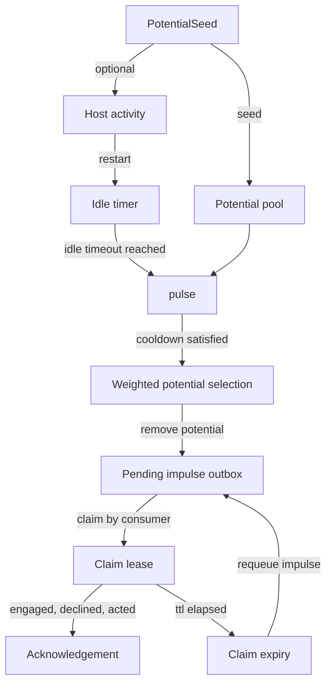
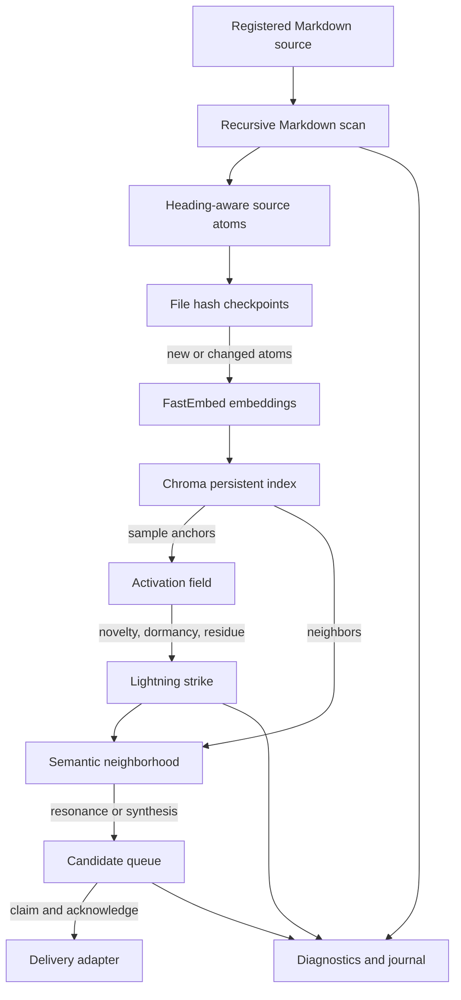
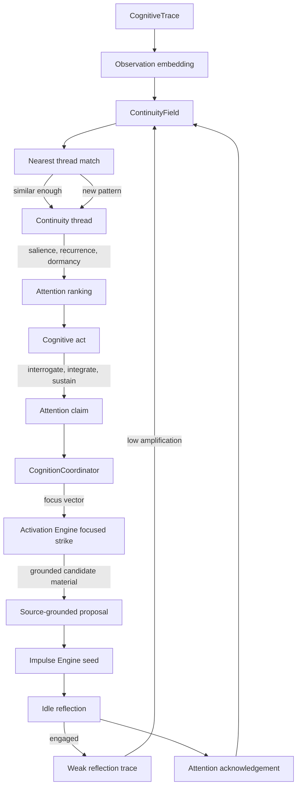
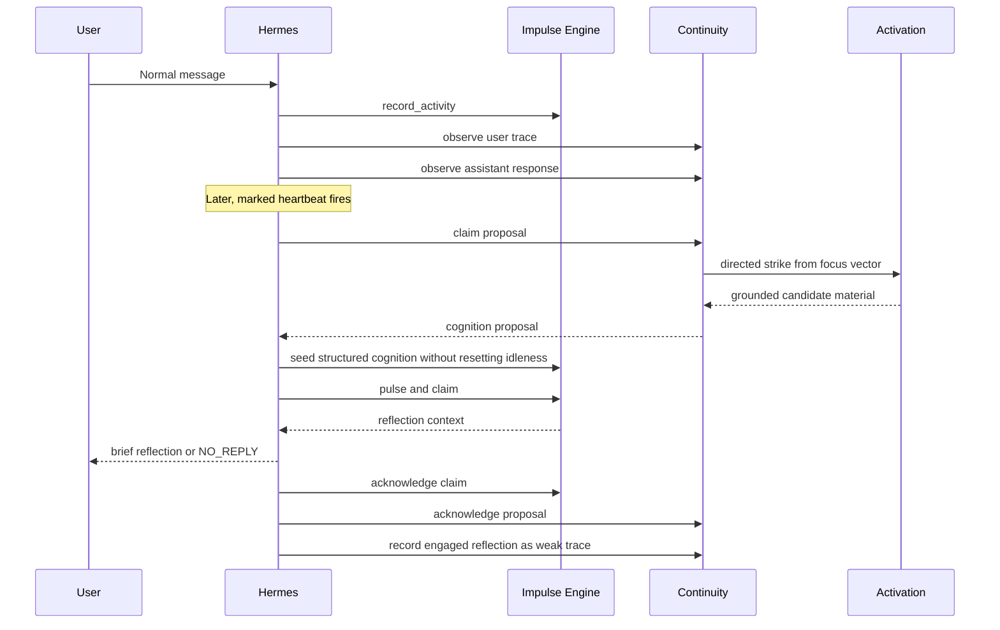

# Impulse Engine Architecture Diagrams

These diagrams describe the current runtime shape of the Impulse Engine, the
optional Activation Engine, and the Continuity layer.

## Whole System

The core is deliberately small. Activation knows source material, Continuity
knows recent conceptual threads, and the Hermes adapter decides when to connect
those layers to an idle reflection turn.

## Impulse Engine Core

The core holds temporary potentials and emits at most one pending impulse per
pulse. Leases keep delivery explicit: consumers claim an impulse and later
acknowledge the outcome; expired claims return to the pending outbox.

## Activation Engine

Ingestion is incremental. A bounded strike starts from one selected source
anchor, inspects one semantic neighborhood, and emits at most one candidate
with source provenance and diagnostic evidence.

## Continuity Layer

Continuity stores compact traces rather than full conversations. Similar traces
merge into threads; recurrence and salience decide whether a thread becomes
attention-worthy. An engaged idle reflection returns as a weak trace, preserving
the possibility of later reinforcement without demanding immediate follow-up.

## Idle Reflection Loop

