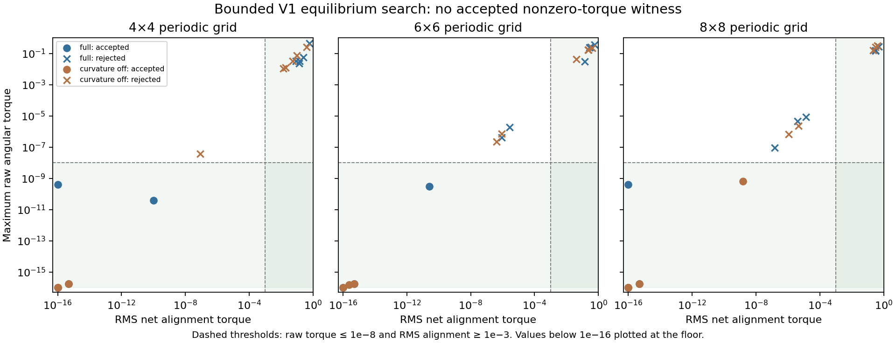

# V1 Equilibria — Search and Shell Balance

## Outcome in plain language

**The numerical search did not find the proposed stable, nonzero-alignment equilibrium.** It completed its fixed search and checks; the scientific witness gate was not passed.

There is also a useful mathematical refinement. At equilibrium, curvature from orientation-driven displacement behaves as a weighted alignment interaction. Substantial stationary tension would require the **shell–curvature feedback** to supply an additional balancing torque. This narrows the mechanism worth investigating; it does not prove that a stable pattern of that kind exists.

Both engines, the original tracker, closed audits and historical results remain unchanged. This is new coverage stacked on the baseline, not a replacement audit or a revision of canonical Genesis theory.

## Frozen search and result

Study ID: `v1_equilibria_2026-10-31`. Parent: `v1_baseline_audit_2026-10-31`.

The study used periodic grids 4×4, 6×6 and 8×8. For each grid it evaluated nine deterministic starting families in full V1 and with curvature disabled: uniform and checkerboard controls, a phase twist, weak wave, smooth forced guess, periodic vortex guess, and three fixed random-angle guesses. Initial displacement guesses were either zero or orientation/tension-based. No parameter, seed family, tolerance or evaluation budget was retuned after observing outcomes.

| Grid | Pipeline | Attempts | Accepted numerical outcomes | Qualifying nonzero-alignment witnesses |
| --- | --- | ---: | ---: | ---: |
| 4×4 | Full V1 | 9 | 4 | 0 |
| 4×4 | Curvature off | 9 | 3 | 0 |
| 6×6 | Full V1 | 9 | 3 | 0 |
| 6×6 | Curvature off | 9 | 3 | 0 |
| 8×8 | Full V1 | 9 | 3 | 0 |
| 8×8 | Curvature off | 9 | 4 | 0 |

There were **54 attempts and 20 accepted outcomes**, not 20 distinct equilibrium types. Accepted outcomes lie at or near the ordinary alignment-stationary class. None has RMS net alignment torque at least 1e-3 while meeting the root residual requirements.



Many solver “success” flags failed the independent residual requirements. Rejected cases include local residual minima, numerical termination and budget exhaustion. Even a weak-wave start can stop above tolerance despite a known nearby uniform solution. This limits what the search can conclude: **failure here does not establish that other equilibria do not exist**.

## Exact root reduction and independent acceptance

At a full static state, tension can be eliminated exactly:

\[
\tau_i^*=\frac{\gamma}{d_\tau}|a_i|,
\qquad a_i=\sum_{j\sim i}\sin(\theta_j-\theta_i).
\]

The solver unknowns are theta, ux and uy. It retains the source's pre-shell compression and post-shell curvature timing. The root residual is raw angular torque T and the displacement recurrence residual divided by displacement decay. Angular mobility q is not used to shrink the force residual.

A numerical outcome is accepted only if:

- Maximum absolute raw T is at most 1e-8.
- A separately executed update through the preserved source changes theta, tau, ux, uy and freshly initialized C by at most 1e-8 in their componentwise maximum norms; theta differences are circular.

The source check includes tension even though it was eliminated from the solve. A solver's stopping status or a small slowed angular increment is not enough.

The optimizer is bounded TRF `least_squares`, with fixed `max_nfev=160`, angular representatives bounded by +/-10pi and displacement components by +/-4.8. The budget refers to SciPy's nfev counter; batched finite-difference Jacobian work adds evaluations outside that counter. These settings define a finite numerical investigation, not an exhaustive root search.

## Stability coverage and what was not triggered

Stability checks retain the active variables **theta, tau, ux, uy**. Eliminating tension is valid for fixed-point solving but not for stability. C is overwritten each step and adds zero eigenvalues if retained as a separate input variable. Disabled memory/inhibitor arrays pass through unchanged and would add neutral directions; the study does not claim asymptotic attraction in those irrelevant allocated fields.

The scheduled checks were performed on accepted uniform/checkerboard controls. They used central finite differences at 1e-6 and 1e-7 plus six prescribed physical perturbations followed for 1,000 model updates. Unperturbed numerical drift was recorded separately from perturbation response.

The controls are at nonsmooth zero-source states. Uniform-state finite-difference radii vary with step size near one; curvature-off uniform states also have a neutral phase direction. These are marked **unresolved or nonsmooth**, not falsely certified as unstable or attracting. Checkerboard radii are near 1.12, and perturbation/base-drift behavior is compatible with expansion, but the smooth certification gate was not asserted there.

No accepted qualifying root existed. Therefore the conditional witness locking-off checks and doubled-grid witness tests were **not triggered**. The local-map tiling identity is unit-tested; this is not a result that a new pattern survives at larger size.

## Analytic refinement: identify the balancing contribution

This deduction was made after the frozen search. It is a separate algebraic result, not a changed search criterion or a way to declare the failed gate passed.

At a full fixed point, let e_i=(cos theta_i,sin theta_i), e_i-perp=(-sin theta_i,cos theta_i), and D the source's centered differences. Displacement equilibrium gives exactly

\[
u_i^*=k\tau_i^*e_i+sDC_i^*,\qquad
k=\frac{\kappa}{d_u}=2,\quad
s=\frac{\eta}{d_u}=1.6.
\]

This follows despite pre-shell compression timing, because at a fixed point the post-shell displacement equals the incoming displacement. Curvature reads that same u-star.

Split the implemented curvature contribution as

\[
R_i=\beta e_i^\perp\!\cdot\Delta u_i^*+\delta_i,
\qquad |\delta_i|\le\beta\epsilon,
\quad\epsilon=10^{-8}.
\]

The bounded delta is the existing epsilon/angle term, including its zero-Laplacian convention; it is not deleted. The orientation-driven displacement then gives

\[
e_i^\perp\!\cdot\Delta(\tau e)_i
=\sum_{j\sim i}\tau_j\sin(\theta_j-\theta_i).
\]

Define positive weights and the shell contribution by

\[
w_i=\alpha+\beta k\tau_i^*>0,
\qquad
S_i=\beta s\,e_i^\perp\!\cdot\Delta DC_i^*.
\]

The stationary raw torque equation becomes

\[
0=T_i=\sum_{j\sim i}w_j\sin(\theta_j-\theta_i)
+b\tau_i^*+S_i+\delta_i,
\qquad b=0.1.
\]

Multiply by w_i and sum over the periodic undirected grid. Each neighbor pair has coefficient w_i w_j and opposite sine signs, so it cancels exactly:

\[
\boxed{
b\sum_iw_i\tau_i^*+
\sum_iw_iS_i+
\sum_iw_i\delta_i=0.
}
\]

This is a **necessary weighted torque budget**, not a proof of equilibrium existence or stability. Positivity assumptions are alpha>0, beta/kappa>=0, d_u>0 and nonnegative tension, all satisfied by the preset. Positive mobility and the inherited no-whole-turn bound are required to infer raw T=0 from static angles.

### Consequence when shell feedback is disabled

With eta=0, S=0. Therefore any exact equilibrium obeys

\[
0\le\frac{\sum_iw_i\tau_i^*}{\sum_iw_i}
\le\frac{\beta\epsilon}{b}=4\times10^{-9}.
\]

If epsilon were zero, stationary tension would vanish exactly, and the tension recurrence would imply a=0. For the actual implementation, the exact inequality already limits any shell-off stationary tension to the tiny epsilon scale in this weighted mean.

Thus curvature of orientation-driven displacement alone is not an unrestricted new counterforce. At equilibrium it contributes to a positive weighted alignment interaction. **Substantial stationary tension requires a negative weighted shell–curvature contribution.** The shell is a specific candidate mechanism, beyond its informal description as boundary sharpening.

This statement does not establish that the shell actually achieves the required balance. It does not exclude geometry-only equilibria with zero net alignment torque, dynamic patterns, relative equilibria or limit cycles.

### Numerical qualification

The inequality is exact at equilibrium. The search's 1e-8 residual tolerances exceed its 4e-9 tension scale, and approximate displacement equilibrium introduces further error terms. It must not be applied literally to finite-tolerance candidates without residual allowances. No shell-off solver campaign was run here; its bound is an analytical consequence, independently checked.

[Nine constructed-field identity checks](../../../results/v1_equilibria_2026-10-31/shell_balance_checks.json) verify the decomposition and weighted cancellation to floating-point accuracy. Those fields obey the equilibrium-form displacement relation only: their random C is not claimed to satisfy the nonlinear compression equation or form a complete equilibrium. The checks validate algebra, not existence.

## Where this leaves the mechanism

The search did not supply the desired numerical witness. The analytic refinement gives a narrower route: investigate whether the self-consistent **C -> shell displacement -> curvature -> angular organization** loop can support an attracting state. That is more specific than assuming compression locking or generic curvature creates stability.

Any further solve should explicitly target the nonlinear shell branch and its compression self-consistency, and record a new protocol. It must not keep expanding this completed search until a desired picture appears. A geometry-only root or dynamically maintained pattern would be a different witness and should be labeled accordingly rather than retroactively changing this gate.

## Reproduction, preservation and artifacts

```powershell
$env:GENESIS_USE_CUPY = 'False'
$env:OPENBLAS_NUM_THREADS = '1'
& .\.venv\Scripts\python.exe -B -m unittest discover -s tests -v
& .\.venv\Scripts\python.exe -B -m src.genesis_equilibria.search --output results/v1_equilibria_new
& .\.venv\Scripts\python.exe -B -m src.genesis_equilibria.shell_balance results/v1_equilibria_new
$env:MPLCONFIGDIR = Join-Path (Get-Location) 'work/matplotlib'
& .\.venv\Scripts\python.exe -B -m src.genesis_equilibria.render results/v1_equilibria_new
```

Existing study and supplement paths are refused. Rendering only reads saved metrics and does not change fits or gates.

- [Frozen protocol and source hashes](../../../results/v1_equilibria_2026-10-31/protocol.json)
- [All attempts, residuals, spectra and perturbation traces](../../../results/v1_equilibria_2026-10-31/report.json)
- [Readable tables and figure](../../../results/v1_equilibria_2026-10-31/summary.md)
- `candidate_states.npz` retains every final active-state vector, including rejected attempts.
- [Equations](../../../src/genesis_equilibria/equations.py), [search](../../../src/genesis_equilibria/search.py), [shell algebra check](../../../src/genesis_equilibria/shell_balance.py), [renderer](../../../src/genesis_equilibria/render.py).
- [[V1 Equilibrium Search — Mathematical Review]] records the separate assistant methods review, not external peer review.

All 36 tests passed, including original regressions and eight new equation/search checks. All 53 V1/V2 engine source hashes and the inherited baseline fingerprints match. Analysis is isolated in `src/genesis_equilibria/` and no existing engine imports it. The solver, kernel, test sources and initial protocol stayed fixed after collection began. The supplemental algebra and presentation are separately fingerprinted.

**Recorded decision:** the bounded search milestone is completed as a study, while the stable nonzero-torque witness gate remains not passed. The weighted shell balance is new conditional mathematical coverage of this implementation. Neither result establishes a novel physical law, autonomous object, matter, emergent physical time or holographic bulk.
