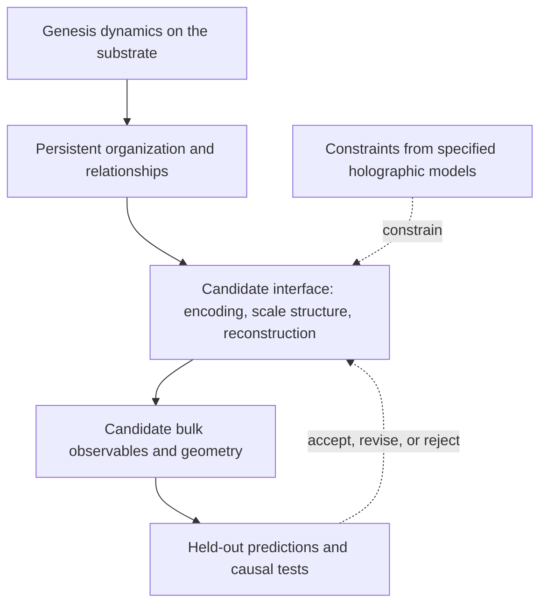

# Genesis to Holographic Bulk — Interface Pathway

## 1. The proposal in plain language

Genesis's proposed job at this layer is to **organize information**, through distinction, relation, emergence, stabilization, and recursion. A proposed higher-layer correspondence would make that organization describable as an actual spatial bulk.

The question is not whether we can draw tension as a hill. It is whether the organization generated by Genesis supports a consistent, predictive geometric description that was not simply drawn into the model.

> Working hypothesis: Genesis dynamics can produce stable relationships across a two-dimensional substrate whose organization supports a higher-dimensional effective description. Holographic physics may constrain the required interface without uniquely specifying the Genesis dynamics.

This is a research hypothesis, not a demonstrated property of V1, a new canonical formulation, or a revival of the P/A programme. “Projection” is retained as the user's name for the proposed higher-layer relation. It does not presuppose an external light, an optical screen, or a temporal process that pushes information outward.

The proposed physical bulk is the long-term target. Early classical analyses can establish useful representations and effective geometry only; they cannot, by themselves, establish spacetime or quantum gravity.

## 2. What is being preserved, and what remains open

The current experimental engine is `src/genesis_grid/`. It stores an angular value at each grid site, along with tension, in-plane displacement, compression, and optional auxiliary state. Its angular state can be written

\[
\theta_i\in S^1,\qquad \mathbf{s}_i=(\cos\theta_i,\sin\theta_i).
\]

There is one angular degree of freedom per site. Two components of a unit vector do not constitute two independent field degrees of freedom.

Let the full state, including enabled auxiliary fields, be

\[
X_n=(\theta,\tau,u_x,u_y,C,\ldots)_n,
\qquad X_{n+1}=F_G(X_n).
\]

This is bookkeeping for the existing model, not a new evolution equation. A snapshot of θ alone is generally insufficient to predict a model with memory in auxiliary fields. See the [state definition](../../../src/genesis_grid/core.py), [alignment rule](../../../src/genesis_grid/rules_alignment.py), and [deformation rule](../../../src/genesis_grid/rules_compression.py).

Current V1 does not include out-of-plane displacement, a quantum state, or a demonstrated holographic dictionary. Individual vortices have model-level evidence as topological objects; that does not establish particles in a bulk. See [[Higher-Order Object Detection Spec]] and the [V1 vortex finding](../../../findings/2026-10-12_v1_topological_objects.md).

The two-dimensional grid and update order are supplied by the simulation. This pathway initially investigates organization given that substrate. It does not claim to derive the substrate or time itself.

The conversation's possible mechanisms remain alternatives:

| Intuition | Operational interpretation | Status |
| --- | --- | --- |
| Hills and valleys | Plot a scalar as height | Visualization; no extra space follows |
| Orthogonal response | Add a coupled, independent field mode | Possible extension requiring a causal role |
| Proto-light through a sheet | Introduce a propagating mediator and a scattering rule | Possible extension, not required by holography |
| Organized substrate supports bulk | Reconstruct bulk observables from substrate information | Central hypothesis of this note |

“Close nodes mean a sink; distant nodes mean a hill” is an encoding proposal, not a geometric identity. Orientation similarity, site separation, and reconstructed distance must be distinguished. Distances alone need not distinguish a hill from its inverted valley.

## 3. What holography can actually constrain

### 3.1 Information capacity: the bulk cannot contain arbitrary extra information

Black-hole entropy motivates an area-based capacity relation. In units with Boltzmann's constant equal to one,

\[
S_{\rm BH}=\frac{A_H}{4\ell_P^2},\qquad
\ell_P^2=\frac{\hbar G}{c^3}.
\]

More general entropy bounds require conditions and an appropriate association between surfaces and spacetime regions; they are not a universal instruction to assign entropy to every ordinary volume by its boundary area. The holographic principle constrains possible descriptions, but does not provide a unique construction algorithm. [Bousso](https://arxiv.org/abs/hep-th/0203101)

**Proposed Genesis requirement:** reconstructed bulk quantities must remain constrained by substrate information. An arbitrarily large collection of independently adjustable voxels cannot be supplied by simply reinterpreting a fixed substrate.

At a declared finite angular resolution of \(q\) bins per site, θ alone on \(N_s\) sites has a maximum discrete entropy

\[
H(\Theta)\leq N_s\log_2 q.
\]

This elementary counting bound is not a black-hole entropy derivation. It excludes auxiliary fields unless they too are discretized and counted; exact classical angles have no finite bit capacity without a precision assumption. Likewise, site count proportional to sheet area is not evidence of gravitational holography or a Planck-scale cutoff.

### 3.2 Dimension bookkeeping: distinguish space from spacetime

The intended target is **two spatial dimensions plus evolution** versus **three spatial dimensions plus evolution**. In AdS/CFT dimensional notation, the corresponding template is AdS\(_4\)/CFT\(_3\), not AdS\(_3\)/CFT\(_2\). This is bookkeeping only: Genesis has not been shown to be a CFT, relativistic, quantum, or dual to AdS. A holographic boundary need not be a black-hole horizon. [Witten](https://arxiv.org/abs/hep-th/9802150)

### 3.3 Organization across scale: a candidate meaning for depth

One concrete inspiration is the proposal to organize a quantum state's information by scale and interpret the resulting structure geometrically. [Swingle](https://arxiv.org/abs/0905.1317)

For Genesis, a deliberately modest classical analogue is

\[
\ell_s=2^s a,\qquad z_s\propto\log(\ell_s/a),
\]

where \(a\) is a bookkeeping grid spacing, \(s\) indexes coarse-graining scale, and \(z_s\) initially labels logarithmic resolution, **not physical depth**. This is a coordinate convention: an AdS-inspired Poincare radial coordinate may instead track \(\ell_s\) directly, as discussed in the companion source note. Neither convention supplies a measured metric or length scale.

This provides a route to investigate the intuition without assuming a new light-like ingredient: the same substrate is described through local and increasingly collective relationships. Drawing these descriptions in layers automatically creates a third plotting axis; it does not automatically create a third spatial dimension. Cross-scale consistency and independent predictions must justify any geometric interpretation. Scale is not simulation time.

### 3.4 A stronger physical benchmark involves quantum entanglement

For appropriate static semiclassical AdS/CFT settings, the leading Ryu–Takayanagi relation is

\[
S_{\rm vN}(A)=\frac{\operatorname{Area}(\gamma_A)}{4G_N}
\quad (\hbar=c=k_B=1),
\]

with a regulated boundary-region von Neumann entropy and a bulk minimal surface anchored on its boundary and satisfying the homology condition. Quantum and time-dependent settings require extensions; this is not a formula applicable to arbitrary classical data. [Ryu and Takayanagi](https://arxiv.org/abs/hep-th/0603001)

**Proposed interface implication:** a physical holographic proposal must account for many compatible information–geometry relationships, not one fitted hill profile. V1 angular histograms and classical mutual information are not quantum entanglement. A separate quantum formulation, or a derivation of the necessary quantum structure, would be required before this physical benchmark could be applied. The entire 2D substrate area, the perimeter of a region within it, and a reconstructed bulk minimal surface are three different objects.

### 3.5 Reconstruction and redundancy constrain the dictionary

AdS/CFT bulk reconstruction explicitly relates local bulk fields to distributed boundary operators in controlled regimes. Holographic quantum error-correcting toy models illustrate constrained bulk encodings and reconstruction from suitable boundary regions. These results motivate reconstruction and erasure tests; they do not establish a Genesis correspondence. [Hamilton et al.](https://arxiv.org/abs/hep-th/0606141), [Pastawski et al.](https://arxiv.org/abs/1503.06237)

The desired classical diagnostic contract is

\[
B_n=\mathcal R(X_n),\qquad
\mathcal R(F_G(X_n))\approx F_B(\mathcal R(X_n)).
\]

Here \(\mathcal R\) is a fixed candidate reconstruction and \(F_B\) is a compact effective evolution rule. The approximation must be tested on declared observables and held-out initial states. Defining an unrestricted \(F_B\) by copying the entire simulator would make this test vacuous. Bulk observables may use a declared finite history if a snapshot is insufficient, but that history increases the information supplied to the decoder and must also be given to comparison models.

For a later quantum formulation, an illustrative encoding contract is an isometry

\[
V:\mathcal H_{\rm code}\rightarrow\mathcal H_{\partial},
\qquad V^\dagger V=I_{\rm code}.
\]

It follows that \(\dim\mathcal H_{\rm code}\leq\dim\mathcal H_{\partial}\). Apparent bulk locality therefore does not imply arbitrary independent information at every bulk point. This is an information constraint, not a claim that current Genesis implements a quantum code.

## 4. A concrete pathway using the existing model first

### Stage A — State an interface hypothesis and freeze the baseline

Record the exact V1 preset, active rules, software revision, grid sizes, seeds, sampling cadence, and analysis windows. Preserve the original engine. No P/A fields, vertical displacement, or mediator is introduced by this note.

Choose the first claim narrowly: **V1 produces reproducible multiscale organization with predictive value beyond ordinary spatial smoothing and the existing local-state baseline.** That is a prerequisite worth testing, not yet holography.

Declare the full state versus θ-only inputs separately. If a proposed θ-only dictionary fails while a full-state dictionary succeeds, report dependence on the auxiliary fields rather than silently crediting θ alone.

### Stage B — Measure organization at more than one scale

For each spatial block \(B\) of width \(\ell\), compute the circular mean vector

\[
m_B=\frac{1}{|B|}\sum_{i\in B}e^{i\theta_i},
\qquad r_B=|m_B|.
\]

Retain both real components of \(m_B\), rather than relying on an undefined mean angle when \(r_B\) is near zero. Add block tension and compression summaries, plus the sum of plaquette winding charges; a circular mean alone can erase a vortex. Use relative-angle or rotation-covariant features where justified by the active preset, and explicitly test coordinate or absolute-angle dependence instead of assuming all optional rules are rotationally invariant.

For discretized block descriptors \(Z_A,Z_B\), an exploratory statistic is classical mutual information:

\[
I(Z_A;Z_B)=\sum_{a,b}p(a,b)\log\frac{p(a,b)}{p(a)p(b)}.
\]

Specify the ensemble defining \(p\): repeated seeds at comparable evolution stages, or justified stationary windows. A single deterministic snapshot does not define its own ensemble entropy. Do not pool transient stages as though stationary; account for correlated samples, binning sensitivity, and finite-sample bias. Pairwise mutual information measures statistical dependence, not causal influence, and can miss higher-order organization.

### Stage C — Construct a candidate scale description, with explicit controls

Represent blocks at scales \(a,2a,4a,\ldots\) and their cross-scale relationships. Any parent-child hierarchy inserted by the analysis is supplied structure. Only measured patterns within that structure can be claimed as discovered.

Use the same analysis on:

- Independent-angle fields with matched one-site statistics.
- Spatial permutations of each snapshot, preserving values while destroying the original arrangement.
- Surrogates preserving pair correlations as closely as the chosen construction permits; disclose what is and is not matched.
- Temporal order controls, preserving snapshots but destroying event sequence.
- An ordinary alignment-only model and the selected V1 geometry ablation.

Temporal shuffling is a diagnostic control, not a physically admissible Genesis trajectory. Geometry-ablation comparisons should distinguish regime changes from the removal of a particular mechanism.

**Stop gate:** if the same apparent depth and structure emerge from these controls, the visualization or representation may be manufacturing the result.

### Stage D — Require the representation to predict something new

Use cloned states and matched small local perturbations. Measure the difference between perturbed and untouched evolution in θ, tension, compression, and tracked structures. Test whether a fixed low-complexity scale representation predicts those responses across held-out seeds.

For angular responses, use circular differences or vector differences, not raw subtraction across the \(0/2\pi\) wrap. Fit at most a declared compact dictionary on training runs. Compare with equal-input, equal-history, and comparably sized local-field and planar models; do not give only the bulk candidate access to auxiliary state or extra history.

One possible predeclared score is

\[
\Delta=\frac{L_{\rm baseline}-L_{\rm candidate}}{L_{\rm baseline}},
\]

for a specified held-out response loss \(L\). Specify the minimum meaningful improvement, uncertainty procedure, and required replication **before evaluating the final cohort**. No numerical threshold or positive result is supplied by this note.

An erasure test can also ask whether selected collective observables remain reconstructible from suitable partial substrate data better than a local baseline. That would demonstrate classical redundancy only. A smooth or repetitive field can be redundant without being holographic.

**Stop gate:** if the new representation gives no replicated explanatory or predictive advantage, do not interpret its plotted depth as space.

### Stage E — Test geometry only after reconstruction earns a role

Infer candidate neighborhoods or distances from training data, then independently test whether the same geometry explains correlations and intervention propagation. Correlation-derived similarity is not automatically a metric; a graph or distance construction introduces assumptions that must be documented.

An observer-like measurement can count states or effective locations within graph distance \(r\):

\[
d_{\rm eff}(r)=\frac{d\log V(r)}{d\log r}.
\]

A local smooth three-dimensional regime can have \(V(r)\propto r^3\), but this is not a universal global signature: curved, especially hyperbolic, spaces can have different large-distance growth. Require agreement among neighborhood structure, independently measured propagation, and scaling across system sizes. Shortcuts, finite-size effects, and arbitrary cross-scale links can mimic individual signatures.

Blocks at different scales overlap in their underlying information. They cannot simply be counted as independent physical locations. Demonstrate independently distinguishable effective observables and consistent response relationships, while respecting encoding constraints.

Success here would support an **effective geometric description**. It would still not establish a holographic duality, quantum spacetime, gravity, or physical matter.

### Stage F — Choose a physical holographic target, or retain a classical analogue

If earlier gates succeed, identify a specific reference framework and derive its missing assumptions explicitly: quantum state space and observables, dynamics, a controlled regime supporting a geometric bulk, compatible entropy relations, and a reconstruction dictionary. Strongly interacting large-degree-of-freedom limits occur in familiar semiclassical examples; the generic holographic principle does not decree one unique microscopic field theory.

A classical multiscale model may remain useful without passing this stage. Do not manufacture a quantum state from a classical probability distribution and claim that its chosen entanglement has been derived from Genesis.

## 5. The next proposed research-sized step

Before changing dynamics, write and execute a small **multiscale organization audit** of V1. Start with θ blocks, winding, tension, and compression, matched controls, and held-out perturbation-response prediction. Reuse the existing object and intervention infrastructure where appropriate.

The audit should produce a finding containing: frozen settings; input/output definitions; estimator and surrogate details; held-out performance and uncertainty; sensitivity to resolution and grid size; negative results; and a decision on whether a geometric reconstruction attempt is justified.

This note specifies that pathway; it does **not** implement or run the audit. A positive first audit would justify a candidate reconstruction study. A negative one would limit the tested representation or regime, not refute all possible Genesis formulations. New mechanisms require a named missing capability and a discriminating test, rather than being added to rescue a picture.

## 6. How to visualize the hypothesis accurately

Use three linked images, with labels distinguishing measured quantities from proposed interpretation:

1. **Substrate:** θ arrows on the existing grid, with actual vortex winding and compression overlays.
2. **Organization:** the same snapshot described through several block scales. Keep the scale axis labeled “resolution,” not physical height or time. Show shared information between layers.
3. **Candidate bulk:** a separate reconstruction with an inset showing which held-out responses it predicts and where it fails. Label this “hypothesized geometry” until the relevant tests pass.

Do not depict an external beam as a required holographic ingredient. Do not depict a stack of time frames as a newly discovered spatial direction. A height map of one scalar is a surface, not by itself a volume.

## 7. Decision ledger

**Execution update, 2026-10-31:** the first classical organization audit has
been implemented and run in an isolated package, preserving V1 and V2.
The fixed multiscale representation did not clear the prediction gate over
matched planar context at either tested grid size. See
[[Genesis Multiscale Organization Audit]] and
[[Genesis Multiscale Organization Audit Results]]. No geometric reconstruction
was attempted, and this result does not advance the bulk hypothesis.

| Claim | Present status |
| --- | --- |
| V1 produces persistent topological vortices | Supported within the documented operational tests |
| Genesis organizes information relevant to a holographic dictionary | Open hypothesis |
| Scale may supply a useful candidate depth coordinate | Literature-inspired proposal to test |
| Current Genesis has a physical 3D bulk | Not demonstrated |
| Proto-light is required | No; optional mechanism only |
| Holography uniquely determines Genesis equations | No |
| V1 should be replaced now | No; analyze its existing organization first |

The retained idea is: **Genesis may supply organized substrate information; holographic models provide demanding examples of what a successful interface would have to preserve and predict.** DDFH may provide further proposed conditions, but its specific equations must be reviewed before claiming compatibility.

## 8. Primary sources and companion note

- [Bousso, The Holographic Principle](https://arxiv.org/abs/hep-th/0203101): entropy bounds and their scope.
- [Witten, Anti De Sitter Space and Holography](https://arxiv.org/abs/hep-th/9802150): a specific boundary/bulk observable dictionary.
- [Ryu and Takayanagi, Holographic Derivation of Entanglement Entropy from AdS/CFT](https://arxiv.org/abs/hep-th/0603001): the static entropy/minimal-surface benchmark.
- [Swingle, Entanglement Renormalization and Holography](https://arxiv.org/abs/0905.1317): organization by scale as a geometric route.
- [Hamilton et al., Holographic Representation of Local Bulk Operators](https://arxiv.org/abs/hep-th/0606141): controlled bulk reconstruction.
- [Pastawski et al., Holographic Quantum Error-Correcting Codes](https://arxiv.org/abs/1503.06237): constrained encoding and reconstruction in toy models.

See [[Genesis Holographic Interface Research Sources]] for source-specific qualifications. Sections 4–6 are proposed Genesis research design, not results asserted by these papers. Created from the user's exploratory discussion on 2026-10-30; no simulation evidence was generated in preparing this note.
