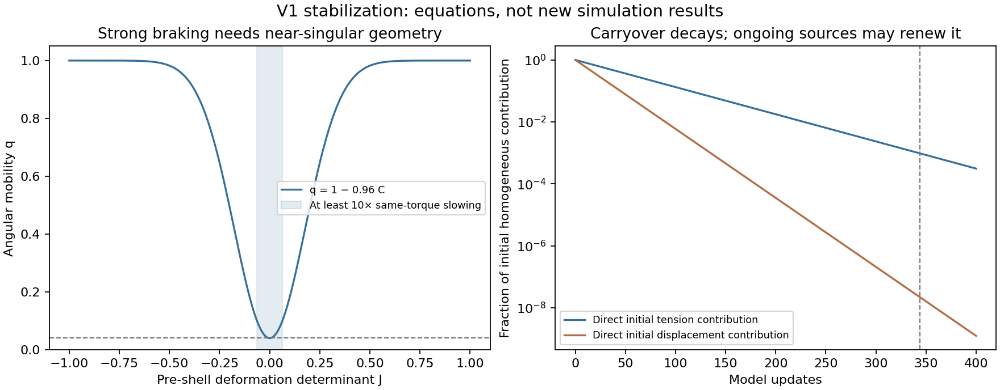

# V1 Stabilization — Mechanism and Discriminating Prediction

## Read this first

**V1 contains a definite mechanism for slowing angular change. That is not yet a proof of self-maintaining organization.** In the audited preset, maximum compression reduces the next angular response to 4% of its unlocked value. It never makes a nonzero turning influence vanish by locking alone.

The stronger result is that changing only locking strength below one leaves the possible full static configurations unchanged. It can change rates, stability and which configurations are reached. The geometry-to-curvature feedback is a separate force-producing mechanism and is where additional stationary angular balance could arise.

This analysis gives a specific next prediction: **at a full static state of this preset with curvature feedback disabled, net alignment torque must vanish at every site. A static pattern maintaining nonzero net alignment torque would require another balancing contribution, supplied here by curvature feedback.** Whether V1 actually has a stable such state remains open.

These are conditional mathematical statements about current source. They are not claims of new physical law, bistability, autonomy, matter, or a holographic bulk. Both V1 and V2 remain untouched. The closed audit is inherited; no new trajectory campaign or predictor fitting was performed.

## 1. Exact discrete map and assumptions

Use the three-rule preset from [make_params and RULES](../../../genesis_v1_compression_ablation.py), with alpha=0.30, gamma=0.01, kappa=0.10, curvature beta=0.04, locking lambda=0.96, shell eta=0.08, tension decay d_tau=0.02, displacement decay d_u=0.05, and angular multiplier h=0.05. Phase/triad terms and their amplification gains are disabled. Updates have the meaning in [[V1 Discrete Update Convention]].

Let e(theta)=(cos theta,sin theta), D the centered spatial difference in unit grid spacing, and Delta the five-point Laplacian. The source implements, in order,

\[
a_i=\sum_{j\sim i}\sin(\theta_j-\theta_i),\qquad
\tau_i^+=(1-d_\tau)\tau_i+\gamma|a_i|,
\]

\[
v_i=(1-d_u)u_i+\kappa\tau_i^+ e(\theta_i),\qquad
J_i=\det(I+Dv_i),\qquad
C_i^+=e^{-J_i^2/s^2},\quad s^2=0.0625+10^{-8},
\]

\[
u_i^+=v_i+\eta DC_i^+,\qquad L_i=\Delta u_i^+,
\]

\[
R_i=\beta(\|L_i\|+\epsilon)
\sin\!\left(\operatorname{atan2}(L_{iy},L_{ix})-\theta_i\right),
\qquad \epsilon=10^{-8},
\]

\[
T_i=\alpha a_i+b\tau_i^++R_i,\quad b=0.1,\qquad
q_i=1-\lambda C_i^+,\qquad
\theta_i^+=[\theta_i+hq_iT_i]_{2\pi}.
\]

Compression is computed from pre-shell displacement v; curvature uses after-shell u-plus. Replacing these with one simultaneous gradient calculation changes the map. The tension source is the magnitude of **net** alignment torque: substantial opposing angular differences can cancel.

Sources: [alignment](../../../src/genesis_grid/rules_alignment.py), [structural updates](../../../src/genesis_grid/rules_compression.py), [curvature](../../../src/genesis_grid/rules_curvature.py), [locking](../../../src/genesis_grid/rules_locking.py), [orchestration](../../../src/genesis_grid/core.py). The independent source check is [[V1 Stabilization — Independent Mathematical Check]].

## 2. What locking proves: finite braking

Since 0<=C<=1,

\[
0.04\le q_i\le1.
\]

At an identical full starting state, enabling or disabling locking leaves all structural calculations and raw T identical for that update. The angular increments differ by q. Maximum same-torque slowing is 25-fold. This is not a bound on object lifetime or a claim that later trajectories remain scaled copies: they generally diverge after the first update.

For at least m-fold immediate slowing,

\[
C\ge\frac{1-1/m}{\lambda},\qquad
|J|\le\sqrt{-s^2\log\!\left(\frac{1-1/m}{\lambda}\right)},
\]

provided the required C is at most one.

| Same-torque slowing | Required C | Required absolute J, approximately |
| --- | ---: | ---: |
| 2-fold | 0.52083 | <=0.20192 |
| 5-fold | 0.83333 | <=0.10675 |
| 10-fold | 0.93750 | <=0.06351 |
| 20-fold | 0.98958 | <=0.02558 |

For comparison, J=0.5 gives C approximately 0.0183 and q approximately 0.9824: only a small response reduction. Strong braking is confined to near-singular deformation, rather than being the automatic consequence of any compression.

## 3. Locking does not add static states in this preset

A full fixed point requires unchanged theta **and** unchanged retained structural variables. With lambda<1, q is strictly positive. Excluding hidden whole-turn updates, unchanged theta therefore requires T=0. Structural updates do not depend on lambda at the same incoming state. Consequently the full fixed-point set is identical for lambda=0 and any 0<=lambda<1, with all other parameters held fixed.

### Why whole-turn aliases do not invalidate this statement here

Starting from the standard zero tension/displacement state, |a|<=4 gives tau<=4 gamma/d_tau=2. Each component of DC is bounded by 1/2, so a displacement-component bound U obeys

\[
U^+\le0.95U+0.24,\qquad U\le4.8.
\]

The Laplacian component magnitude is at most 8U, hence

\[
|T_i|\le1.2+0.2+0.04(8\sqrt2\,4.8+10^{-8})<3.573,
\qquad |hq_iT_i|<0.179<2\pi.
\]

The same force bounds apply to bounded nonnegative-tension fixed points of the preset by their equilibrium recurrences. Thus an apparently unchanged angle cannot hide a full revolution. Larger parameters, a different rule set or arbitrary large initial states require revisiting this bound. At lambda=1, q can vanish, and the fixed-point-set conclusion no longer follows.

**Equal fixed-point sets do not imply equal stability, basins, cycles or lifetimes.** Multiplying only the angular response by a spatially varying q changes its relation to structural relaxation. Code comments asserting freezing or bistability are not a proof that two attracting states exist.

## 4. Alignment with braking has a descent property

To separate braking from additional forces, consider a reference subsystem retaining alignment and any mobility 0<q<=1, but excluding both the tension angular drive and curvature torque. This reference is not the full V1 pipeline.

Define an alignment diagnostic, with each periodic east/south bond counted once,

\[
E(\theta)=\sum_{\langle ij\rangle}[1-\cos(\theta_j-\theta_i)],\qquad
\nabla E=-a.
\]

This is a mathematical potential for the alignment term, not a demonstrated conserved physical energy of Genesis. Its gradient has a global Euclidean Lipschitz bound of eight: the Hessian is a nearest-neighbor weighted Laplacian with bond weights bounded by one in magnitude.

For t=h alpha and theta-plus=theta+tQa, the descent bound is

\[
E(\theta^+)-E(\theta)
\le -t\sum_i q_i a_i^2+4t^2\sum_i q_i^2a_i^2
\le-t(1-4t)\sum_i q_i a_i^2.
\]

Here t=0.015<1/4, so the coefficient is 0.0141. This holds pointwise even if q evolves through structural state. Modulo wrapping leaves E unchanged. Braking can slow relaxation of this reference; it does not create a new alignment potential. This does not select a unique uniform final state or rule out ordinary metastable stationary configurations.

The full model's b tau and R contributions remove this simple guarantee: they can inject or remove the alignment diagnostic. No full-model Lyapunov function or energy conservation is established by this argument.

## 5. What extra static balance would require

At a full fixed point, tau-star=(gamma/d_tau)|a|=0.5|a|. If curvature is disabled, the raw torque becomes

\[
T_i=0.3a_i+0.05|a_i|
=\begin{cases}0.35a_i,&a_i\ge0,\\0.25a_i,&a_i<0.\end{cases}
\]

It vanishes only when a_i=0. Thus changing geometry and locking without curvature cannot support a static angular pattern with nonzero net alignment torque in this preset. This does not rule out dynamic or rotating patterns, and a briefly unchanged theta snapshot does not imply equilibrated tension.

With curvature enabled, stationarity instead requires

\[
R_i=-0.3a_i-0.05|a_i|.
\]

This is a concrete torque-budget prediction. On the periodic grid, unweighted raw alignment torques sum to zero by edge antisymmetry. Summing the **stationary raw equations**, not the mobility-weighted transient increments, gives

\[
\sum_i R_i=-0.1\sum_i\tau_i^*.
\]

Nonzero stationary tension therefore requires negative net curvature torque to balance the supplied positive tension drive. The condition is necessary, not proof that such a state exists or attracts nearby states.

**Discriminating prediction:** if full V1 supports a genuinely stationary nonzero-a structure, an otherwise identical curvature-off system cannot have that same kind of full static angular balance. Lock removal alone is a weaker discriminator because it leaves all static configurations available.

## 6. Retained state versus continuing renewal

The direct homogeneous carryover of initial tension decays as 0.98^n; its half-life is approximately 34.31 updates. For displacement it is 0.95^n, with half-life 13.51 updates.

After 344 updates, these direct initial contributions are approximately 0.000959 and 2.17e-8. This suggests a useful future review interval for distinguishing direct carryover from continuing sources, but it does not erase indirect consequences carried through theta.

Tension can be continually supplied by |a|. Displacement can be supplied by both tension-driven orientation and eta DC. In particular, turning off the tension source does **not** prove that shell-on geometry must vanish. Conversely, a long-lived vortex need not owe its life to this feedback: ordinary angular topology and alignment remain alternative explanations.

Under an explicitly shell-off, slowly varying-source approximation,

\[
\tau\approx\frac\gamma{d_\tau}|a|,\qquad
u\approx g|a|e(\theta),\qquad
g=\frac{\kappa\gamma}{d_ud_\tau}=1\text{ at the preset}.
\]

Then with M=D(|a|e(theta)), J approximately equals det(I+gM)=1+g tr(M)+g^2 det(M). The determinant identity is exact after the approximate substitution. It illustrates why compression depends on spatial organization, not kappa alone. It neither establishes a universal onset threshold nor rules out bounds or ensemble transitions. The actual preset has eta=0.08, so this closure is an illustration, not its exact equilibrium solution.

## 7. A diagnostic that separates slowing from balance

For any saved state calculate F=alpha a+b tau-plus, R, T=F+R, and q. A small angular increment can come from small q, small net T, or both.

A candidate cancellation indicator is

\[
\chi_i=\frac{|F_i+R_i|}{|F_i|+|R_i|+\varepsilon_{\rm diagnostic}}.
\]

Small chi indicates opposing force contributions; it does not establish stability. Small motion with chi near one and small q is compatible with braking. A full fixed-point claim additionally needs a small structural-update residual, since structural state could still be evolving beneath a quiet theta pattern. Diagnostic floors and tolerances must be specified before an empirical claim; none is tuned from current results here.

## 8. What a decisive next calculation would be

The next mathematical target is a nonuniform full-state fixed point, with the necessary torque budget above, followed by a stability analysis and an isolated curvature-off comparison. Ordinary alignment-stationary configurations are the reference. Nonzero-a equilibria, if found, distinguish maintained force balance from slowing alone.

A persistent vortex identity can coexist with changing angles and structural
fields. Fixed-point analysis tests one strong form of stabilization; it does
not exhaust periodic, rotating, moving or otherwise dynamically maintained
objects. Failure to find a static balance would not refute those possibilities.

At points where a=0, the absolute-value source is not differentiable. At zero displacement Laplacian, the implemented epsilon/angle prescription also needs care. A blind finite-difference Jacobian is not automatically a reliable stability proof there; use suitable directional or explicitly justified numerical analysis.

If a later trajectory experiment is needed, first fix the candidate-selection rule, residual and recurrence criteria, intervention branches, and observation window. Include full V1, locking-off and curvature-off comparisons plus a clearly defined alignment reference. Preserve source order and initial conditions; changes belong in a separate adapter. Establish continuing source/force balance over the derived carryover interval before making a self-maintenance claim.

No campaign is commissioned or run by this note. If the only evidence remains a transient plateau or immediate lock-off speed increase, retain the narrower interpretation of finite slowing. Hysteresis requires its own stationary/attractor evidence and cannot be inferred from a finite-rate parameter ramp alone.

## 9. Verification, limits and provenance

[Closed-form results and one-update checks](../../../results/v1_stabilization_derivation_2026-10-31/checks.json) were generated by [stabilization_math.py](../../../src/genesis_audit/stabilization_math.py). The independently transcribed staged equations agree with existing V1 on all 24 archived starting states from the prior motion experiment, to a maximum array residual of 4.44e-16. The locked/unlocked one-update relation agrees to 8.89e-16. Each state was evaluated for one locked and one unlocked update only; no future trajectory cohort was generated.

The [manifest](../../../results/v1_stabilization_derivation_2026-10-31/manifest.json) fingerprints the analysis source, inherited baseline manifest and input archives. The parent source/evidence/environment verifier passes. Neither engine, original tracker, prior gates nor previous records was changed.

A small source artifact matters to exact statements: at L=0, atan2(0,0)=0 and epsilon leaves R=-beta epsilon sin(theta), bounded in angular increment by 2e-11 per update here. This adds a tiny absolute-angle dependence and means not every uniform orientation is an exact fixed point with curvature enabled. No repair or measured physical effect is claimed. It does not affect the positive-mobility proof, which retains the implemented R.

A separate assistant review checked the fixed-point, no-curvature, potential-descent and torque-budget arguments. This is conditional mathematical coverage of a specific implementation, not external peer review. No global coupled stability, bistability, new energy law, continuum limit, physical time, matter or novelty relative to all prior models has been established.
