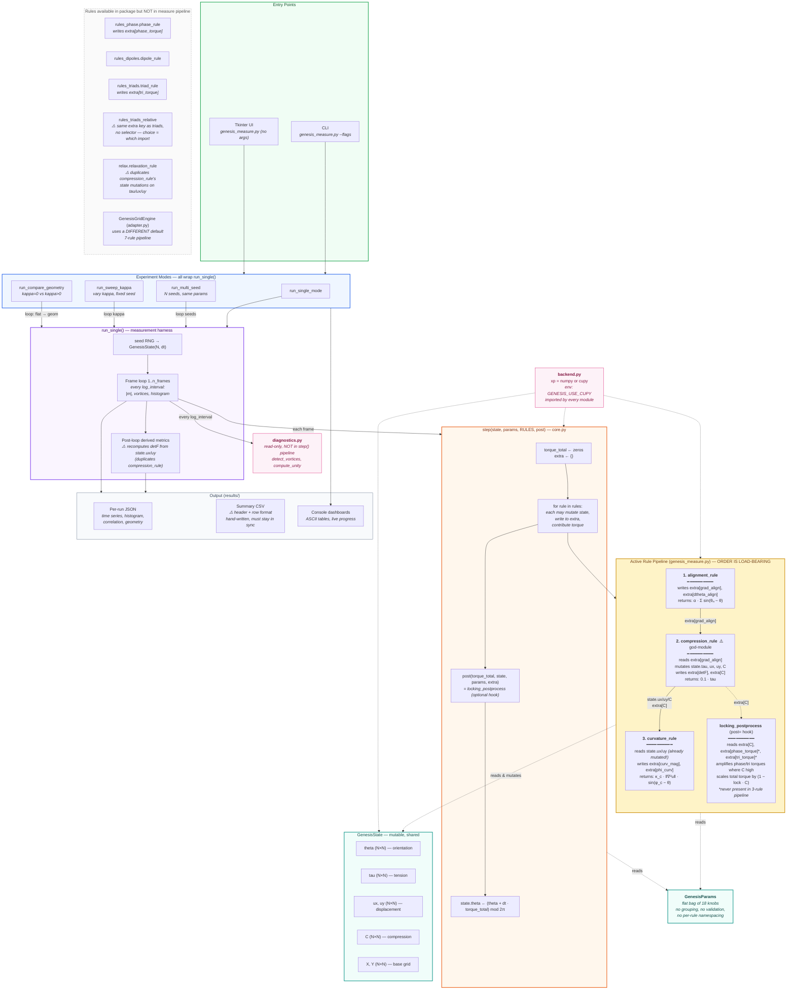

Here's a diagram that reflects what the code actually does — making implicit dependencies visible and flagging the structural hazards from the analysis:

## What changed and why

**Made implicit dependencies visible.** Each rule now lists what it _reads from_, _mutates_, _writes to extra_, and _returns_ — so you can see at a glance why reordering the list breaks things. The labeled arrows between R1→R2→R3 show exactly which keys flow through `extra`.

**Separated "returns torque" from "mutates state".** `alignment_rule` is pure (returns torque only). `compression_rule` mutates four state fields _and_ returns torque. The diagram now treats those as different behaviors instead of glossing over them.

**Showed both pipelines.** The active 3-rule pipeline used by `genesis_measure.py` is in the bright box; the 7-rule adapter default and the orphaned rules are in the dashed-grey "available but unused" box so it's obvious there are two parallel realities.

**Surfaced the cross-cutters.** `backend.py` (numpy/cupy switch) and `diagnostics.py` (out-of-pipeline read-only) are now visible as their own concerns instead of being hidden.

**Flagged the duplication.** Arrows from `FINAL` and notes on `compression_rule` vs `relaxation_rule` make the duplicated `detF` / `tau`/`ux`/`uy` logic explicit.

**Honest about `locking_postprocess`.** Showed that two of its three inputs (`phase_torque`, `tri_torque`) are never produced by the active pipeline — the lock currently only freezes torque, it doesn't amplify anything.

Want me to save this to a markdown file in your repo (e.g. `genesis_engine_architecture.md`) so it doesn't overwrite the existing `architecture.md`?