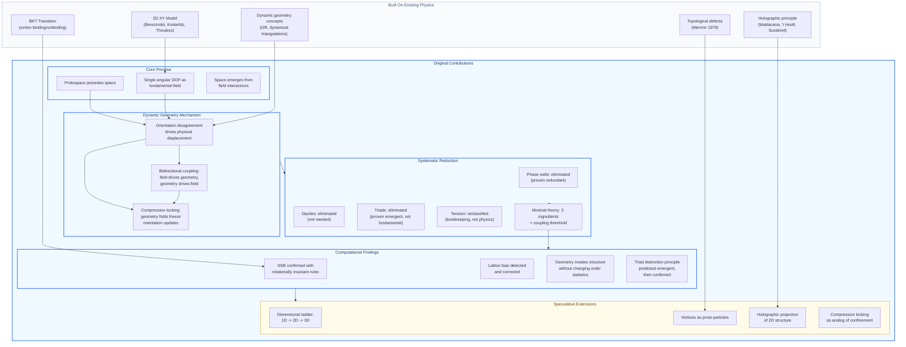

# Genesis Scheme — Theoretical Framework and Computational Results
## Report for External Analysis
### Joshua Boudreaux — April 12, 2026

---

## Purpose of This Document

This report describes a computational physics research project exploring whether a minimal one-dimensional field on a dynamic discrete substrate can spontaneously produce geometric structure and symmetry breaking. It is intended to be analyzed by a separate system for theoretical rigor, novelty assessment, and identification of connections to existing physics.

The author requests: honest assessment of the theory's coherence, identification of which claims are supported by the computational evidence, which are speculative, and what formal mathematical work would be needed to make the results publishable or falsifiable.

---

## The Theory (Original to This Work)

### Core Premise

Reality at its most fundamental level consists of a one-dimensional angular degree of freedom (an orientation, theta) at each point of a **protospace** — a substrate that precedes physical space. Physical space, forces, structure, and ultimately matter emerge from the interactions between these orientations and the response of the protospace to them.

The protospace is explicitly not space. It is the substrate from which spatial structure is produced. The simulation grid represents the protospace, not a discretization of physical space.

### The Three Ingredients

Through systematic computational elimination, the theory reduces to three non-arbitrary ingredients:

**1. Alignment (local coupling):**
Each cell interacts with its four nearest neighbors via the torque sin(theta_neighbor - theta). This is claimed to be the unique lowest-order local interaction between angular DOFs that respects continuous rotational symmetry. It is mathematically identical to the nearest-neighbor coupling in the classical 2D XY model.

**2. Dynamic geometry (the core hypothesis):**
Orientation disagreement between neighbors generates a tension field. This tension drives physical displacement of the protospace itself — each cell drifts in the direction of its orientation, proportional to accumulated tension. The protospace deforms in response to its own field content. When deformation causes sufficient compression (the determinant of the deformation gradient approaches zero), orientation updates in that region slow toward zero. This "compression locking" is a consequence of the geometry, not a separately imposed rule.

**3. Curvature feedback (closure of the loop):**
The Laplacian of the displacement field generates a torque on the orientation. This creates a bidirectional coupling: orientation drives geometry, geometry drives orientation. Without this feedback, the geometric deformation would be a passive visualization with no physical consequence.

### What Is Claimed to Emerge

From these three ingredients alone, given sufficient geometry coupling strength:

- Spontaneous symmetry breaking (the rotationally invariant system selects a preferred orientation)
- Discrete orientation domains with sharp boundaries
- Domain wall networks forming 2D structure on the protospace
- Topological defects (vortices) that cannot be removed by local operations
- Compression zones at geometric folds
- Physical deformation of the protospace (density variations, strain patterns)

### The Dimensional Ladder (Speculative)

The full theoretical framework proposes a chain:

1D orientation field -> knotted forces (topological defects) -> 2D boundary network -> 3D holographic projection

Only the first two links have been computationally explored. The holographic step is entirely speculative within this work.

### Distinction Principle (Explored but Found Emergent)

A "triad" rule — encoding the concept of same/differentiating/different as a 3-body angular relationship — was initially hypothesized as a fundamental ingredient. Computational experiments showed that the minimal system WITHOUT triads produces spontaneous symmetry breaking when geometry coupling is sufficient. The relational structure that triads encode appears to arise naturally from alignment and dynamic geometry interacting. This was a prediction made during the research and subsequently confirmed.

---

## Relationship to Existing Physics

### Direct Implementation: The 2D XY Model

The alignment rule implements the classical 2D XY model exactly. This model is extensively studied (Berezinskii 1970, Kosterlitz & Thouless 1973, Nobel Prize 2016). Known properties:

- Supports topological defects (vortex-antivortex pairs)
- Exhibits the BKT phase transition: below T_BKT, vortex pairs bind; above, they unbind
- In 2D, exhibits quasi-long-range order (algebraically decaying correlations), not true long-range order in the thermodynamic limit (Mermin-Wagner theorem)

The Mermin-Wagner theorem states that continuous symmetries cannot be spontaneously broken in 2D systems with short-range interactions at finite temperature. This is relevant: any SSB observed in the simulation at finite N must be assessed against finite-size effects. The claim that dynamic geometry circumvents or modifies this theorem would require formal proof.

### Related but Distinct: Elasticity-Coupled Order Parameters

In condensed matter, there are systems where an order parameter couples to lattice strain (magnetoelastic coupling, ferroelastic materials). The key difference: in those systems, the lattice has its own elastic energy and dynamics independent of the order parameter. In this work, the lattice has no independent dynamics — its deformation is entirely driven by the orientation field.

### Related but Distinct: Dynamical Triangulations / Quantum Gravity

In approaches to quantum gravity (Regge calculus, causal dynamical triangulations), the geometry itself is a dynamical variable. The difference: those approaches discretize spacetime geometry using edge lengths or triangle areas as degrees of freedom, with the geometry contributing to a gravitational action. This work uses a fixed-topology square grid with continuous displacement fields, not a triangulation with variable connectivity. The geometric dynamics here are simpler but also less general.

### Related but Distinct: Gauge Theory on a Lattice

In lattice gauge theory, the fundamental variables are group elements on links between sites (not angles on sites). This distinction matters: the XY model has global U(1) symmetry; gauge theories have local gauge invariance. The simulation does not implement a gauge theory despite superficial similarities.

---

## Computational Results

### Experiment 1: Spontaneous Symmetry Breaking (Multi-Seed)

**Setup:** Minimal system (alignment + dynamic geometry + curvature feedback + compression locking). No phase wells, no dipoles, no triads. All rules are rotationally invariant — no absolute angle preferences exist anywhere in the code. Central differences used in compression computation to eliminate lattice directional bias (bias was detected and corrected during research).

**Protocol:** 20 independent runs at N=200, 10,000 frames each. Same parameters, different random seeds. Measured: order parameter magnitude |m| and angle for each run.

**Results:**
- |m|: mean=0.105, std=0.057, range [0.012, 0.206]
- Angle: std=1.738 radians (theoretical uniform on circle: pi/sqrt(3) = 1.814)
- Angles span full range: 0.25 to 6.01 radians
- 18/20 runs show |m| > 0.05

**Interpretation:** The angle distribution is statistically consistent with uniform on the circle. The system selects an arbitrary direction with no preference. |m| is consistently above zero but modest, indicating partial ordering with competing domains.

**Caveat:** The |m| > 0 at N=200 could be a finite-size effect. The 2D XY model on a finite lattice also shows |m| > 0 that decreases as N increases. To distinguish genuine SSB from finite-size quasi-order requires scaling analysis (|m| vs N at fixed parameters).

### Experiment 2: Lattice Bias Control

**Setup:** Same experiment but with forward-difference (asymmetric) compression computation.

**Results:** Angle std=0.218 — all 20 runs clustered near theta=1.4 (grid diagonal).

**Interpretation:** Forward differences create a directional bias. Central differences eliminate it. This control experiment validates the methodology and demonstrates the importance of symmetric numerical schemes.

### Experiment 3: Geometry Comparison (kappa=0 vs kappa>0)

**Setup:** 20 seeds, each run twice — once with kappa=0 (alignment only, flat protospace) and once with kappa=0.097 (dynamic geometry). N=100, 25,000 frames.

**Results:**
- |m|: kappa=0 mean=0.262, kappa=0.097 mean=0.266 (+1.6%) — no significant difference
- Vortices: essentially identical
- Displacement: 0 -> 0.151 (mean), 0 -> 1.462 (max) — cells physically moved
- Compression: 0 -> 4.88% of cells in compression (folded)
- Strain heterogeneity: 0 -> 0.290 — non-uniform deformation
- Wall density and vortex spacing: no significant difference

**Interpretation:** Dynamic geometry does not significantly alter the orientation ordering statistics compared to alignment alone. Both systems produce the same |m|, same vortex count, same domain structure by global measures. Geometry adds physical deformation — compression, strain, displacement — that does not exist at kappa=0. The two systems are statistically identical in their orientation field but structurally different in their protospace geometry.

**Open question:** Whether the geometric deformation has its own emergent spatial structure (correlations, characteristic scales) has not yet been measured. This is the critical next measurement.

### Experiment 4: Kappa Sweep

**Setup:** 20 values of kappa from 0 to 0.1, N=100, 25,000 frames, single seed per value.

**Results:** |m| approximately flat across all kappa values (range 0.387-0.518, no clear threshold).

**Interpretation:** No phase transition detected at this grid size and frame count. The ordering appears to be dominated by alignment, with geometry not producing a sharp transition in global order. However, single-seed sweeps are noisy and may miss the transition. Multi-seed sweeps at each kappa value would be needed for conclusive results.

---

## What Is Uniquely Original in This Work

---

## Assessment Requested

For the analyzing system, the following assessments would be valuable:

1. **Theoretical coherence:** Does the premise (1D angular DOF on a dynamic protospace producing emergent geometry) constitute a well-posed theoretical framework, or is it underdetermined? What mathematical formalism would be needed to make it precise?

2. **Novelty:** The specific combination of XY model + dynamic lattice deformation + compression locking does not appear in the literature. Is this genuinely unexplored, or does it reduce to a known system under some transformation?

3. **Mermin-Wagner:** The simulation shows |m| > 0 at finite N with rotationally invariant rules. To what extent could the dynamic geometry modify the Mermin-Wagner theorem's applicability? Does the compression locking mechanism (which effectively creates an inhomogeneous, state-dependent coupling) change the conditions under which the theorem holds?

4. **Continuum limit:** The system has discrete dynamics on a square lattice. Is there a natural continuum field theory that this system discretizes? If so, what is its action? The orientation field theta with alignment coupling gives the standard XY/O(2) sigma model. What does the geometric coupling add to the action?

5. **The geometry comparison result:** Two systems with identical orientation statistics but different protospace geometry. Is this a meaningful physical distinction, or is the geometric deformation merely a coordinate transformation with no physical content? Under what conditions would the geometric structure be a genuine degree of freedom rather than a gauge artifact?

6. **Connection to existing programs:** Does this work have meaningful connections to any of the following: loop quantum gravity, causal dynamical triangulations, emergent gravity programs (Verlinde, Jacobson), condensed matter analog gravity models, or active matter / self-deforming media?

7. **What would constitute a publishable result?** Given the current computational infrastructure and results, what specific measurement or theoretical derivation would cross the threshold from "interesting exploration" to "publishable physics"?

---

## Technical Details

### Code Repository

All code is in the GenesisScheme repository. The minimal system is implemented in:
- `src/genesis_grid/core.py` — GenesisState, GenesisParams, step()
- `src/genesis_grid/rules_alignment.py` — XY coupling
- `src/genesis_grid/rules_compression.py` — deformation gradient, compression field, shell geometry
- `src/genesis_grid/rules_curvature.py` — Laplacian feedback
- `src/genesis_grid/rules_locking.py` — compression locking post-processor
- `genesis_measure.py` — headless measurement script with multi-seed, kappa sweep, and geometry comparison modes

### Reproducibility

All measurement results are in `results/` as JSON files with full time series, histograms, correlation functions, and parameters. Every run is reproducible with a fixed random seed. The central-difference fix for lattice bias is documented and the biased control data is preserved for comparison.

### Parameters for the Definitive SSB Result

alpha=0.3, gamma=0.01, kappa=0.097, curv=0.04, lock=0.96, phase=0, dipole=0, triads=0, N=200, 10000 frames, central differences in compression rule.
