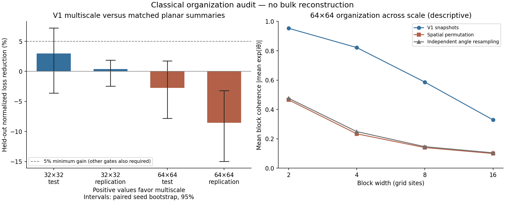

# V1 Multiscale Organization Audit Does Not Clear Its Prediction Gate

Date: 2026-10-31. This is an exploratory classical analysis of a fixed V1 preset. Genesis V1 and V2 were preserved. No spatial bulk, holographic correspondence, quantum entanglement, conserved energy or matter was demonstrated.

## Result

Nested multiscale block summaries did not show a replicated predictive advantage over matched planar-shell summaries. The primary gate was not passed at either grid size.

| V1 grid | Unseen cohort | Loss reduction versus planar | Paired-seed bootstrap 95% interval | Seed wins |
| --- | --- | ---: | --- | ---: |
| 32×32 | Test, seeds 101–106 | +3.00% | [-3.60%, +7.21%] | 3/6 |
| 32×32 | Replication, seeds 201–206 | +0.39% | [-2.44%, +1.88%] | 3/6 |
| 64×64 | Test, seeds 101–106 | -2.74% | [-7.82%, +1.76%] | 2/6 |
| 64×64 | Replication, seeds 201–206 | -8.55% | [-14.99%, -3.20%] | 0/6 |

Positive reduction favors the multiscale model. The 64×64 replication favored the planar representation throughout the reported bootstrap interval. The other intervals overlap zero. Do not turn the small positive 32×32 point estimates into a success claim.

## Question and frozen design

Does a multiscale summary improve prediction of local perturbation responses beyond a same-dimensional planar summary of the same input region?

The [protocol](../results/multiscale_audit_2026-10-31/protocol.json) was saved before collection. It specifies grids 32 and 64; V1, alignment-only, and geometry-ablation pipelines; 6 training seeds and two disjoint 6-seed evaluation cohorts; snapshots at frames 300, 450, 600; and four centers per snapshot. This produced 108 seed archives and 1,296 cloned perturbation events across six datasets, with three target values per event.

Each center receives a Gaussian angular pulse of amplitude 0.30 radians and width 1.5 cells in one cloned branch. After 80 updates, the phasor RMS response relative to an untouched cloned branch is measured in rings [0,2), [2,4), [4,8). The source trajectory remains untouched. Pulses have global tails, so these are response measurements, not propagation-speed or causal-cone tests.

The multiscale and planar models use the same local-site summary and equal numbers of context features over an identical outer square footprint. Context widths are 2, 4, 8, 16. Nested blocks and disjoint shells are alternative summaries of the same underlying sites; neither receives new information or an extra physical coordinate.

The primary model uses θ plus summaries of enabled structural state. A θ-only track is secondary. A fixed ridge predictor with penalty 10 is trained only on seeds 1–6; test and replication targets do not select parameters, features or thresholds. Features are standardized and target losses normalized with training statistics only. Bootstrap resamples preserve independent seed groups.

To pass, in each unseen cohort the primary model must improve by at least 5%, have a positive paired-seed 95% bootstrap lower bound, and win at least 5 of 6 seeds against each of planar-shell, shuffled-context and training-mean models. Both V1 grid sizes must pass. The matched planar comparison alone fails these requirements throughout.

## What the descriptive controls show

Original V1 snapshots have more spatial coherence than their shuffled versions. At 64×64, mean block coherence at widths 2, 4, 8, 16 was approximately 0.953, 0.822, 0.586, 0.329; joint spatial permutation gave 0.465, 0.234, 0.140, 0.100. This demonstrates spatial organization in those snapshots, as expected from local alignment. It does not establish organization unique to Genesis or holography.

The multiscale model's V1 point-estimate losses improve on shuffled context and the training mean in both cohorts and sizes. That is compatible with contextual information being useful. It does not establish that a nested scale representation is preferable to ordinary planar context. Alignment-only and geometry-ablation comparisons also fail their analogous track gates; see the complete tables in the [rendered summary](../results/multiscale_audit_2026-10-31/summary.md).

The phase-scrambled surrogate is not exactly correlation matched after unit-angle projection. Its mean relative phasor-spectrum mismatch was about 0.323 at 32×32 and 0.328 at 64×64 for V1. No claim of organization beyond all pair correlations is justified by this control.

## Preservation and validation

- The audit is in `src/genesis_audit/` with a separate `genesis_multiscale_audit.py` runner. V1 and V2 do not import it.
- SHA-256 hashes of all 53 checked V1/V2 Python sources matched before and after the run.
- Exact preset parity with the existing V1 experiment passes.
- The original four V2 regression tests pass, including zero-coupling V1 parity.
- Fourteen additional audit tests pass: circular responses, periodic winding parity, matched masks, controls, seed isolation, training-only normalization, detached cloning/snapshots, RNG preservation, geometry ablation and end-to-end artifacts.
- Raw input snapshots, descriptors, response targets and held-out predictions are retained. Run time was approximately 65 seconds on the recorded local CPU environment, not a performance benchmark.

## Limits and decision

This is a finite classical test with 6 seeds per cohort, 12 events per seed, four block widths, a single perturbation amplitude/horizon, and a fixed linear ridge family. It does not exhaust nonlinear representations, other regimes, or possible holographic models. Both models have access to the same footprint but use different nonlinear summaries, so even a gain could reflect representation or regularization rather than emergent space. The summary-based full-state track is not a lossless decoder.

No mutual information, quantum entanglement, bulk encoding, independent depth, geometric locality or gravitational dynamics was reconstructed. Time is still the supplied update sequence; space is still the supplied periodic grid.

**Decision:** this protocol does not justify interpreting the scale axis as spatial depth or advancing this particular representation directly to a bulk claim. Preserve the negative result and fixed gates. Any follow-up must state a distinct missing capability or hypothesis, select its design before evaluating fresh seeds, and keep both V1 and V2 intact. Do not add a third dimension or tune features just to force the intended interpretation.

## Reproduction and artifacts

- [Implementation and exact commands](../docs/Genesis%20Scheme%20Vault/30-Implementation/Genesis%20Multiscale%20Organization%20Audit.md)
- [Protocol, parameters, environment and source hashes](../results/multiscale_audit_2026-10-31/protocol.json)
- [All quantitative results](../results/multiscale_audit_2026-10-31/report.json)
- [Rendered tables and plot](../results/multiscale_audit_2026-10-31/summary.md)
- Raw per-seed snapshots and targets: `results/multiscale_audit_2026-10-31/N<size>/<pipeline>/seed_<seed>.npz`.
- Exact model predictions: `results/multiscale_audit_2026-10-31/N<size>/<pipeline>/forecasts.npz`.

The protocol records the underlying Git revision and independent source hashes because the working tree already contained unrelated changes. No pre-existing source or unrelated document changes were reverted.
