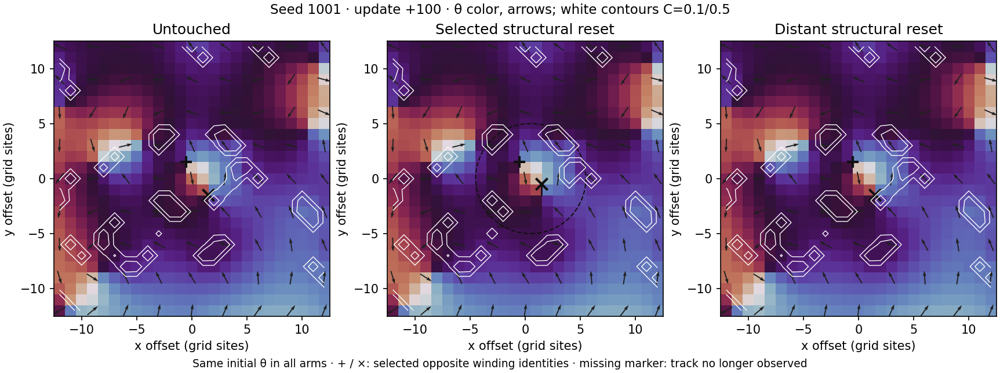
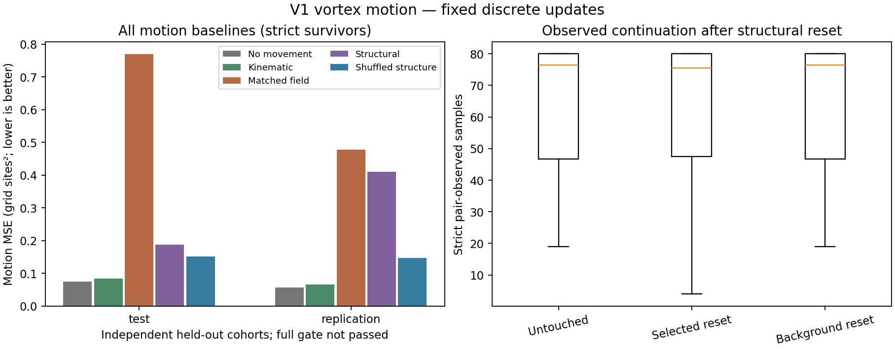

# V1 Vortex Motion: Some Matched Trajectory Effects, No Predictive Gate Success

Date: 2026-10-31. Parent: `v1_baseline_audit_2026-10-31`. This is new coverage of object motion, inheriting the closed baseline. V1/V2 and the historical tracker remain unchanged.

## Outcome

The experiment selected one eligible opposite-charge pair in each of 24 fresh seeds and recorded 8,102 forecast anchors across three matched structural-state branches. All start with identical θ. The selected pair is embedded in a populated field, not isolated from other vortices.

At update +100, both identities were observed in all arms for 22 seeds. In **3 of those 22**, the selected structural reset changed the tracked pair position relative to untouched; background reset produced zero pair position divergence in all 22. Each nonzero selected divergence was approximately 0.707 sites RMS across the two members, corresponding to a one-site displacement of one member.

The mean selected-minus-background position divergence was **0.0964 sites**, with a paired-seed 95% bootstrap interval **[0, 0.2250]**. It did not clear the declared strictly-positive lower-bound criterion. This is a conditional observation on common observed identities, not a population-wide interaction law. Two seeds lack this joint horizon coverage.

The structural-state predictor **did not pass the full motion gate**, and its strict-continuation predictor did not pass the secondary gate. Most forecast anchors had zero grid-resolved motion; the simple no-motion baseline outperformed the learned motion models on average in both unseen cohorts.

## Motion prediction

Loss is mean squared error over x/y displacement, averaged within seed and then across independent seeds. Motion is conditional on strict identity survival to the horizon. Lower is better.

| Model | Test cohort MSE | Replication MSE |
| --- | ---: | ---: |
| No movement | 0.07415 | 0.05681 |
| Kinematic | 0.08291 | 0.06542 |
| Local field, smaller input | 0.13633 | 0.14414 |
| Matched-capacity field | 0.76863 | 0.47777 |
| Structural state | 0.18723 | 0.40988 |
| Shuffled structural state | 0.15176 | 0.14656 |

The structural model improves over the poor matched-field predictor by 75.64% and 14.21%, but loses to shuffled structure and persistence. That single favorable comparison is not sufficient. Large field-model error demonstrates poor performance of this fixed feature/predictor combination; it does not establish which conditioning or generalization mechanism caused the failure.

In the test cohort, 332/2,416 surviving anchors had nonzero (>0.1 site) displacement; in replication, 276/2,361 did. Repeated anchors and intervention branches are not independent experiments: uncertainty uses eight held-out seeds per cohort.

The complete relative-gain intervals and seed wins for every comparator, along with the secondary continuation forecasts, are in the [saved summary](../results/vortex_motion_2026-10-31/summary.md).

## Visual encounter

Seed 1001 was selected for visualization because it was the first eligible training seed, before future trajectories or fit performance were inspected. The left and right arms show the same selected neighborhood under untouched and distant-reset conditions. The middle arm resets structure locally while keeping starting θ identical. At +100, one selected marker has moved by one site in that arm.

[Animated encounter](../results/vortex_motion_2026-10-31/encounter.gif). Phase color and arrows show θ; white contours show compression indicator C=0.1/0.5. The dashed circle marks the selected reset neighborhood; the distant reset is outside the displayed crop.

## Frozen method

- N=64, existing V1 structural preset, `dt=0.05`, durations measured in updates.
- Training seeds 1001–1008; unseen test 2001–2008; unseen replication 3001–3008. No seed was excluded by the eligibility policy in this run.
- Fixed 800-update burn-in; 100-update tracker warmup; candidate observed age at least 50; opposite-charge separation 3–16 sites; selection maximizes present midpoint compression.
- Untouched, selected-structure reset, and periodic-antipode background reset branches. Reset τ/ux/uy/C together with radius-5 compact cosine taper. Starting θ is identical. Shape is matched; amount of removed state is not.
- Follow 400 updates, sample every 5; horizon 100. Separate conservative periodic matching with no gap bridging; historical tracker unchanged.
- Structural versus matched-field models each use 24 features and fixed ridge penalty 10. No future or branch labels enter inputs. Inputs are standardized using training data only.
- Both unseen cohorts must beat every declared motion comparator by at least 5%, have a positive paired-seed bootstrap lower bound and win at least 6/8 seeds. Gates were written to the protocol before collection and were not relaxed.

Median pair-observed samples after the start were 76.5 untouched, 75.5 selected reset and 76.5 background out of 80 possible samples. This summary is descriptive and does not replace the primary motion or forecast endpoints.

## What this adds, and what it does not

The observed matched cases show that changing retained structural variables can change subsequent grid-resolved vortex trajectories while leaving starting θ unchanged. They are consistent with the earlier local-structure causal lead. The across-seed conditional motion contrast remains unresolved under the declared criterion, and the particular compact predictor lacks demonstrated transferable skill against strong simple baselines.

This experiment differs from the historical strict pair-continuation test in intervention taper, pair selection, tracking policy and endpoints. It does not overwrite that result. Nor does it establish that structural state was generated by the selected vortices alone: the surrounding populated field contributes.

Conservative matching can terminate on ambiguity, and track loss is not proof of annihilation. Conditional motion does not cover post-loss dynamics. A single pair is selected per seed in a high-compression regime that may favor stationary structures. These results do not exhaust other regimes, nonlinear predictors, long horizons or sub-grid core locations. No parameters or features were subsequently retuned on these evaluation cohorts.

No autonomous object dynamics, universal two-body force law, novel physical interaction, physical energy, emergent time or holographic bulk was demonstrated.

## Preservation and artifacts

All 53 checked V1/V2 source hashes match; the closed baseline source/evidence/environment verifier passes. All 28 tests passed, including ten new observation/evaluation checks and original regressions. Raw initial states, selected-ID trajectories, descriptors, targets and exact predictions are saved.

- [Protocol and source fingerprints](../results/vortex_motion_2026-10-31/protocol.json)
- [Quantitative report](../results/vortex_motion_2026-10-31/report.json)
- [Tables, plots and replay](../results/vortex_motion_2026-10-31/summary.md)
- [Implementation and reproduction commands](../docs/Genesis%20Scheme%20Vault/30-Implementation/V1%20Vortex%20Motion%20Experiment.md)

The renderer was revised after collection to display all comparators rather than foregrounding the favorable matched-field comparison. `presentation.json` fingerprints that presentation and the unchanged numerical report. Simulation, observation and fitting sources, protocol, outputs, metrics and thresholds were not changed.

**Decision:** retain the observed counterfactual trajectory differences as limited evidence, retain both failed predictive gates, and do not promote a general interaction law. Any follow-up must state a distinct hypothesis and use new evaluation seeds. The baseline audits remain inherited and closed for their original scopes.
