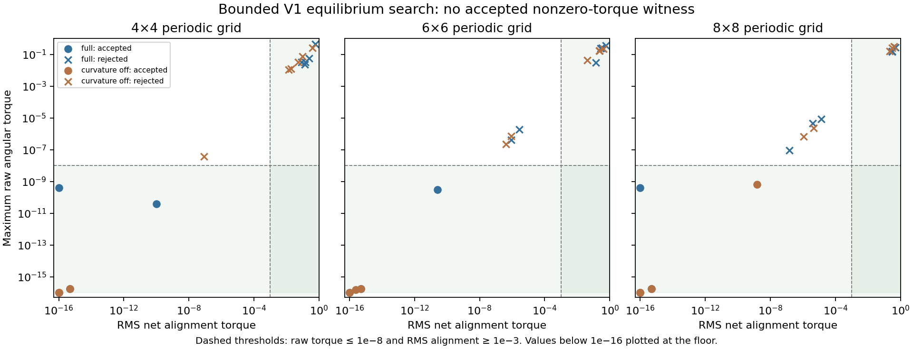

# V1 equilibrium search

Bounded numerical equilibrium search and active-state local checks for one preserved discrete preset; no exhaustive nonexistence, autonomy, matter, physical time or holography claim.

Attempts: **54**. Accepted numerical roots: **20**. Accepted nonzero-alignment witnesses: **0**.
Milestone gate: **not passed**. Preserved engines unchanged: **True**.

Acceptance is a finite residual criterion, not an existence proof. A solver success flag alone was not accepted.

| Grid | Model | Attempts | Accepted | Nonzero-alignment witnesses | Solver success but rejected |
| --- | --- | ---: | ---: | ---: | ---: |
| 4×4 | full | 9 | 4 | 0 | 3 |
| 4×4 | curvature_off | 9 | 3 | 0 | 5 |
| 6×6 | full | 9 | 3 | 0 | 5 |
| 6×6 | curvature_off | 9 | 3 | 0 | 6 |
| 8×8 | full | 9 | 3 | 0 | 2 |
| 8×8 | curvature_off | 9 | 4 | 0 | 5 |

## Stability coverage

Only uniform/checkerboard controls qualified for the scheduled checks. Their zero-source/nonsmooth locations prevent ordinary Jacobian certification under this protocol. Some uniform directions are nearly neutral; checkerboard spectra show expansion near 1.12, with numerical base drift explicitly recorded. “Unresolved” does not mean the uniform state was proved unstable.

No accepted interesting root existed, so conditional locking-off and doubled-grid witness tests were not triggered. The known local tiling identity is unit-tested; this is not empirical larger-grid validation of a new pattern.

## Complete attempt log

| ID | Solver success | Accepted | Max raw torque | RMS alignment | SciPy nfev |
| --- | --- | --- | ---: | ---: | ---: |
| N4_full_uniform_control | True | True | 0 | 0 | 0 |
| N4_full_checkerboard_control | True | True | 1.71451e-16 | 4.89859e-16 | 0 |
| N4_full_twist_reference | True | True | 4e-10 | 0 | 6 |
| N4_full_weak_wave | True | True | 3.93561e-11 | 1.00296e-10 | 20 |
| N4_full_smooth_forced_guess | True | False | 0.444186 | 0.576406 | 46 |
| N4_full_periodic_vortex_guess | False | False | 0.0329947 | 0.0829914 | 160 |
| N4_full_random_11 | True | False | 0.0238977 | 0.134059 | 57 |
| N4_full_random_23 | True | False | 0.0339567 | 0.142716 | 52 |
| N4_full_random_37 | False | False | 0.058473 | 0.247584 | 160 |
| N4_curvature_off_uniform_control | True | True | 0 | 0 | 0 |
| N4_curvature_off_checkerboard_control | True | True | 1.71451e-16 | 4.89859e-16 | 0 |
| N4_curvature_off_twist_reference | True | True | 0 | 0 | 0 |
| N4_curvature_off_weak_wave | True | False | 3.85657e-08 | 8.48902e-08 | 22 |
| N4_curvature_off_smooth_forced_guess | True | False | 0.258073 | 0.406597 | 43 |
| N4_curvature_off_periodic_vortex_guess | False | False | 0.0127465 | 0.0194842 | 160 |
| N4_curvature_off_random_11 | True | False | 0.0108788 | 0.0139092 | 61 |
| N4_curvature_off_random_23 | True | False | 0.0321055 | 0.0527395 | 43 |
| N4_curvature_off_random_37 | True | False | 0.0760688 | 0.0989807 | 56 |
| N6_full_uniform_control | True | True | 0 | 0 | 0 |
| N6_full_checkerboard_control | True | True | 1.71451e-16 | 4.89859e-16 | 0 |
| N6_full_twist_reference | True | True | 3.1406e-10 | 2.55277e-11 | 9 |
| N6_full_weak_wave | True | False | 4.04051e-07 | 8.78956e-07 | 24 |
| N6_full_smooth_forced_guess | False | False | 0.0314462 | 0.139131 | 160 |
| N6_full_periodic_vortex_guess | True | False | 1.90199e-06 | 2.67511e-06 | 26 |
| N6_full_random_11 | True | False | 0.24176 | 0.266679 | 52 |
| N6_full_random_23 | True | False | 0.368609 | 0.56878 | 40 |
| N6_full_random_37 | True | False | 0.258189 | 0.334165 | 131 |
| N6_curvature_off_uniform_control | True | True | 0 | 0 | 0 |
| N6_curvature_off_checkerboard_control | True | True | 1.71451e-16 | 4.89859e-16 | 0 |
| N6_curvature_off_twist_reference | True | True | 1.55431e-16 | 2.48253e-16 | 0 |
| N6_curvature_off_weak_wave | True | False | 2.24963e-07 | 4.27331e-07 | 22 |
| N6_curvature_off_smooth_forced_guess | True | False | 0.0443551 | 0.0414861 | 46 |
| N6_curvature_off_periodic_vortex_guess | True | False | 7.06058e-07 | 8.93867e-07 | 26 |
| N6_curvature_off_random_11 | True | False | 0.175148 | 0.245951 | 49 |
| N6_curvature_off_random_23 | True | False | 0.233293 | 0.405387 | 55 |
| N6_curvature_off_random_37 | True | False | 0.170444 | 0.218717 | 52 |
| N8_full_uniform_control | True | True | 0 | 0 | 0 |
| N8_full_checkerboard_control | True | True | 1.71451e-16 | 4.89859e-16 | 0 |
| N8_full_twist_reference | True | True | 4e-10 | 5.55112e-17 | 6 |
| N8_full_weak_wave | True | False | 8.99139e-08 | 1.5007e-07 | 22 |
| N8_full_smooth_forced_guess | False | False | 8.75052e-06 | 1.31932e-05 | 160 |
| N8_full_periodic_vortex_guess | True | False | 4.57558e-06 | 4.06292e-06 | 22 |
| N8_full_random_11 | False | False | 0.153977 | 0.308294 | 160 |
| N8_full_random_23 | False | False | 0.271909 | 0.500865 | 160 |
| N8_full_random_37 | False | False | 0.161138 | 0.312026 | 160 |
| N8_curvature_off_uniform_control | True | True | 0 | 0 | 0 |
| N8_curvature_off_checkerboard_control | True | True | 1.71451e-16 | 4.89859e-16 | 0 |
| N8_curvature_off_twist_reference | True | True | 3.88578e-17 | 5.55112e-17 | 0 |
| N8_curvature_off_weak_wave | True | True | 6.44723e-10 | 1.47625e-09 | 20 |
| N8_curvature_off_smooth_forced_guess | True | False | 6.70341e-07 | 1.09577e-06 | 27 |
| N8_curvature_off_periodic_vortex_guess | True | False | 2.29032e-06 | 4.4218e-06 | 36 |
| N8_curvature_off_random_11 | True | False | 0.163679 | 0.221675 | 50 |
| N8_curvature_off_random_23 | True | False | 0.325874 | 0.387537 | 94 |
| N8_curvature_off_random_37 | True | False | 0.265661 | 0.294715 | 54 |

## Scope

The frozen 160 max_nfev budget is SciPy’s reported function-evaluation counter. Batched finite-difference Jacobian evaluations add work outside that counter. No budget, parameter, acceptance threshold or witness criterion was changed after results.

A bounded multistart failure does not establish nonexistence. Rejected cases include stalled optimization and budget exhaustion. Dynamic/rotating structures and geometry-only equilibria with zero alignment torque are outside the specific nonzero-alignment witness gate.

## Artifacts

- [Frozen protocol](protocol.json)
- [Metrics and stability traces](report.json)
- `candidate_states.npz`: all final active-state vectors, including rejected attempts.
- [Separate shell-balance algebra checks](shell_balance_checks.json)

The shell-balance supplement is a post-search analytical deduction, not a changed search criterion or a successful equilibrium witness.
