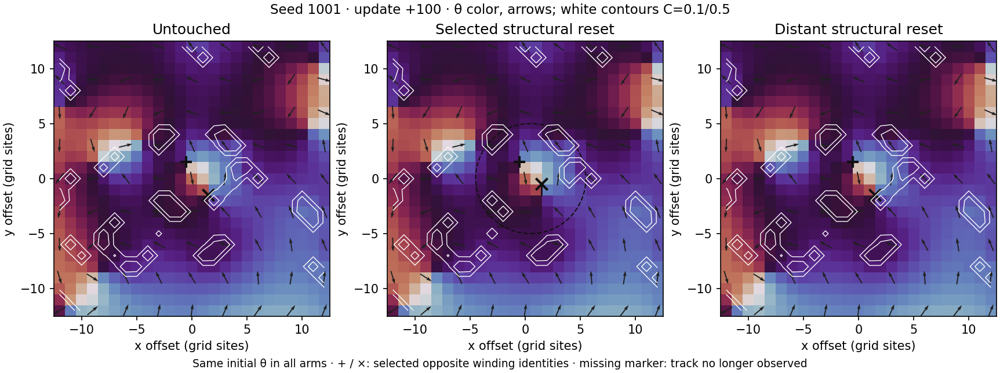
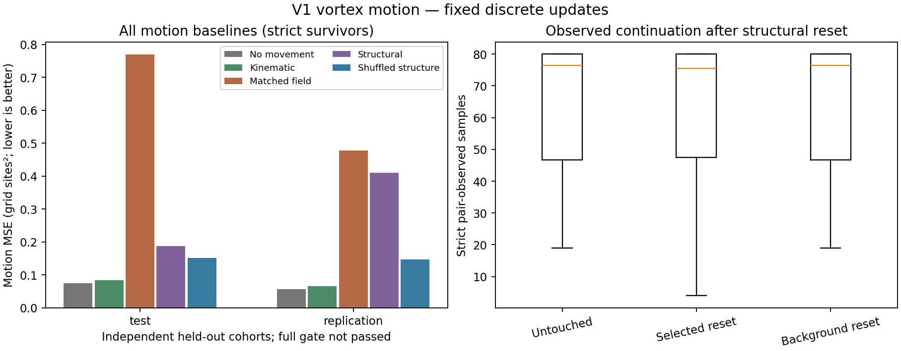

# V1 vortex motion and structural-state encounter

Specific-regime observed vortex trajectories and compact forecasts under joint structural-state interventions; not a universal interaction law, autonomous matter, emergent time or holography.

Eligible seeds: **24**. Forecast records: **8102**. V1/V2 sources unchanged: **True**.

Motion gate: **not passed**. Strict-continuation secondary gate: **not passed**.

The structural model must beat every declared comparator. A large gain against a poor field model alone is insufficient; inspect the no-movement and shuffled-structure references too.

| Cohort | Target | Comparator | Loss reduction | 95% seed interval | Seed wins | Comparator gate |
| --- | --- | --- | ---: | --- | ---: | --- |
| test | motion | field_matched | +75.64% | [+45.36%, +88.83%] | 6/8 | Passed |
| test | motion | shuffled_structure | -23.37% | [-91.63%, +19.78%] | 3/8 | Not passed |
| test | motion | persistence | -152.49% | [-237.98%, -72.57%] | 1/8 | Not passed |
| test | continuation | field_matched | -39.60% | [-219.59%, +17.37%] | 1/8 | Not passed |
| test | continuation | shuffled_structure | -55.77% | [-129.30%, -6.82%] | 2/8 | Not passed |
| test | continuation | persistence | -117.43% | [-764.85%, +3.57%] | 1/8 | Not passed |
| replication | motion | field_matched | +14.21% | [-116.17%, +66.03%] | 5/8 | Not passed |
| replication | motion | shuffled_structure | -179.66% | [-308.10%, -58.29%] | 1/8 | Not passed |
| replication | motion | persistence | -621.47% | [-1972.88%, -374.77%] | 0/8 | Not passed |
| replication | continuation | field_matched | +20.47% | [-17.03%, +49.94%] | 4/8 | Not passed |
| replication | continuation | shuffled_structure | -42.95% | [-105.93%, -4.01%] | 2/8 | Not passed |
| replication | continuation | persistence | -7.19% | [-81.31%, +34.63%] | 3/8 | Not passed |

## Conditional motion contrast

{
  "joint_observed_seed_count": 22,
  "eligible_seed_count": 24,
  "seed_ids": [
    1001,
    1002,
    1003,
    1004,
    1005,
    1006,
    1007,
    2001,
    2002,
    2003,
    2004,
    2005,
    2006,
    2007,
    2008,
    3001,
    3002,
    3003,
    3004,
    3006,
    3007,
    3008
  ],
  "mean_selected_minus_background_position_divergence": 0.09642365197998376,
  "paired_seed_bootstrap_95_interval": [
    0.0,
    0.2249885212866288
  ],
  "positive_conditional_motion_contrast": false,
  "coverage_limit": "Conditional on strict observation of both identities in all arms at the horizon; report lost identities separately."
}

## Visual replay

Representative seed: 1001, selected before inspecting future results. Spatial crop around the selected pair; the background intervention is outside this crop.

[Animated encounter](encounter.gif)

## Artifacts

- [Frozen protocol](protocol.json)
- [All metrics](report.json)
- `forecasts.npz`: event inputs, targets and exact held-out predictions.
- `seed_<seed>.npz`: initial full state, target trajectories, and representative fields for the visual seed.

## Limits

- Fresh seed cohorts, one selected pair per seed, one grid size and one regime; not a universal interaction law.
- Conservative periodic identities can terminate on matching ambiguity or missed observations; tracker loss is not automatically physical destruction.
- Structural reset is a counterfactual state intervention, not proof that two naturally occurring histories realize the compared states.
- Joint structural reset does not identify separate effects of tension, geometry, compression or history.
- State-removal magnitude differs between selected and background neighborhoods; control matches shape and position policy, not energy or amount.
- Per-seed clustering controls repeated observations, but small cohorts and fixed ridge models limit generalization.
- An incremental forecast gain would support state-dependent object modeling, not autonomous closure, novel physics, physical time, matter or holography.
